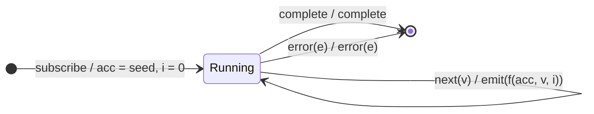

# `scan` as a Mealy Machine

> `scan(accumulator, seed)` applies an accumulator function over the source,
> emitting each intermediate accumulated result. It is the "running total"
> operator. Unlike `reduce`, it emits on **every** `next`, not just on
> `complete`.

Signature used in this analysis:

```ts
scan<V, A>(accumulator: (acc: A, value: V, index: number) => A, seed: A)
```

For clarity we assume a `seed` is provided. (The seedless overload is noted at
the end.)

---

## 1. The 6-Tuple  M = (Q, Σ, Λ, δ, λ, q₀)

### Q — States

The only thing `scan` remembers between notifications is the **current
accumulated value** `acc` and the **index** `i`. So the state is parameterised:

- `Running(acc, i)` — operational, holding accumulator `acc`, next index `i`.
- `Done` — terminal state after `complete` or `error` (no further output).

> `scan` has no "have I started yet?" distinction when a seed is supplied — the
> seed *is* the initial accumulator. This is what makes it simpler than
> `distinctUntilChanged`.

### Σ — Input alphabet (notifications from the source)

- `next(v)` — a source value.
- `complete` — source completed.
- `error(e)` — source errored.

### Λ — Output alphabet (notifications emitted downstream)

- `emit(x)` — emit accumulated value `x`.
- `complete` — forward completion.
- `error(e)` — forward error.
- `noop` — emit nothing on this transition.

### δ, λ — Transition & Output functions

Because this is a **Mealy** machine, the output is attached to the
**transition**, not the state. The defining behaviour of `scan` is that each
input `next(v)` produces exactly one output `emit(...)` **in the same step**.

### q₀ — Initial state

`q₀ = Running(seed, 0)` — on subscription, the accumulator is the seed and no
value has been emitted yet.

---

## 2. State Transition Table (STT)

| #  | Current state     | Input (Σ)   | Guard        | Next state (δ)              | Output (λ)                     |
|----|-------------------|-------------|--------------|-----------------------------|--------------------------------|
| 1  | `Running(acc, i)` | `next(v)`   | —            | `Running(f(acc,v,i), i+1)`  | `emit(f(acc, v, i))`           |
| 2  | `Running(acc, i)` | `complete`  | —            | `Done`                      | `complete`                     |
| 3  | `Running(acc, i)` | `error(e)`  | —            | `Done`                      | `error(e)`                     |
| 4  | `Done`            | any         | —            | `Done`                      | `noop` (channel already closed)|

Where `f` is the user-supplied accumulator.

> Row 4 is the "trap"/terminal row. In real RxJS the subscription is torn down,
> so no further inputs arrive — it is included for formal completeness.

---

## 3. State Transition Diagram (STD)



Edge label convention is `input / output` (standard Mealy notation).

---

## 4. From STT rows to test cases

Each row of the STT is a behaviour to verify. Rows map to marble tests:

- **Row 1** (the self-loop, exercised repeatedly): feed several `next` values
  and assert the running accumulation is emitted each time.
- **Row 2**: source completes → output completes after the last emission.
- **Row 3**: source errors → output errors, no accumulated emission for the
  error frame.
- **Row 4**: nothing is emitted after termination (verified implicitly by the
  completion/error tests — no trailing marbles).

See `tests/01-scan.test.ts`. Each `it(...)` block is annotated with the STT row
it covers.

---

## Note on the seedless overload

Without a seed, `scan` uses the **first value as the initial accumulator** and
emits it unchanged. That adds one extra state:

- `Fresh` — no accumulator yet. `next(v) → Running(v, 1) / emit(v)`.

i.e. `q₀ = Fresh`, and the first `next` seeds instead of accumulating. This is
structurally identical to the `S0 → S1` bootstrap you'll see in
`distinctUntilChanged`.
