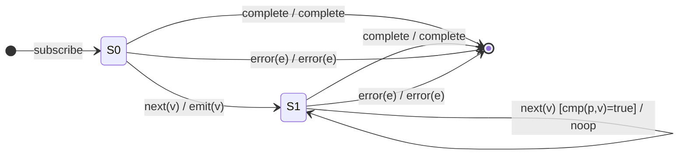

# `distinctUntilChanged` as a Mealy Machine

> `distinctUntilChanged(comparator?)` emits a value only when it differs from
> the **previous emitted** value. Consecutive duplicates are suppressed;
> non-consecutive duplicates are **not** (that's `distinct`). Default comparator
> is `===` (`Object.is`-like strict equality in v7).

Signature used in this analysis:

```ts
distinctUntilChanged<V>(comparator?: (prev: V, curr: V) => boolean)
```

`comparator` returns `true` when two values are considered **equal** (and thus
the new one is suppressed). Default: `(a, b) => a === b`.

---

## 1. The 6-Tuple  M = (Q, Σ, Λ, δ, λ, q₀)

### Q — States

This operator needs a genuine **bootstrap** distinction, because the *first*
value has nothing to compare against and must always be emitted:

- `S0` — no value has been emitted yet (nothing to compare against).
- `S1(p)` — the last emitted value was `p` (parameterised by `p`).
- `Done` — terminal state after `complete` / `error`.

### Σ — Input alphabet

- `next(v)` — a source value.
- `complete`
- `error(e)`

### Λ — Output alphabet

- `emit(v)`
- `complete`
- `error(e)`
- `noop`

### δ, λ — Transition & Output (Mealy: output on the edge)

The **guard** on `next(v)` from `S1(p)` is the comparator:

- `cmp(p, v) === true`  → duplicate → stay, emit nothing.
- `cmp(p, v) === false` → changed  → update state, emit.

### q₀ — Initial state

`q₀ = S0`.

---

## 2. State Transition Table (STT)

| #  | Current state | Input (Σ)   | Guard              | Next state (δ) | Output (λ)   |
|----|---------------|-------------|--------------------|----------------|--------------|
| 1  | `S0`          | `next(v)`   | — (first value)    | `S1(v)`        | `emit(v)`    |
| 2  | `S1(p)`       | `next(v)`   | `cmp(p, v)` = true | `S1(p)`        | `noop`       |
| 3  | `S1(p)`       | `next(v)`   | `cmp(p, v)` = false| `S1(v)`        | `emit(v)`    |
| 4  | `S0`          | `complete`  | —                  | `Done`         | `complete`   |
| 5  | `S1(p)`       | `complete`  | —                  | `Done`         | `complete`   |
| 6  | `S0` / `S1(p)`| `error(e)`  | —                  | `Done`         | `error(e)`   |
| 7  | `Done`        | any         | —                  | `Done`         | `noop`       |

> Rows 4 and 5 are deliberately **separate** even though their output is the
> same: they originate from different states, so they are distinct edges in the
> STD and distinct test cases (empty source vs. completed-after-emitting).

---

## 3. State Transition Diagram (STD)



---

## 4. From STT rows to test cases

| STT row | Test name                                              |
|---------|--------------------------------------------------------|
| 1       | first value always emits (S0 -> S1)                    |
| 2       | suppresses a consecutive duplicate (self-loop, no emit)|
| 3       | emits when the value changes; classic a-a-b-b-a; custom comparator |
| 4       | empty source completes with no emission                |
| 5       | completes after having emitted                         |
| 6       | forwards error from either state                       |
| 7       | (implicit) no trailing marbles after termination       |

See `tests/02-distinctUntilChanged.test.ts`.

> **Guard coverage tip:** Rows 2 and 3 are the same input symbol `next(v)`
> distinguished only by the guard. Good FSM-derived testing demands at least
> one case where the guard is **true** and one where it is **false** — that is
> exactly the duplicate vs. changed pair. The custom-comparator test proves the
> guard predicate is pluggable, not hard-wired to `===`.
