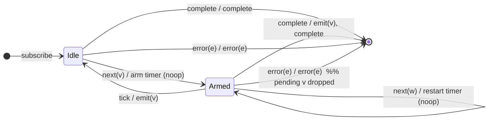

# `debounceTime` as a Mealy Machine

> `debounceTime(d)` emits a value from the source **only after** `d`
> milliseconds have passed **without** another source emission. Each new source
> value resets ("restarts") the silence timer and discards the previously
> pending value. This is the first operator in this study where **time is an
> input symbol**.

Signature:

```ts
debounceTime<V>(dueTime: number, scheduler?)
```

---

## 1. Why time becomes part of Σ

Stateless operators react only to source notifications. Time-based operators
also react to the **passage of time** — specifically to a scheduled timer
firing. To model this as a finite machine we add a synthetic input symbol:

- `tick` — "the debounce timer that was armed `d` ms ago has now fired".

In the RxJS TestScheduler this corresponds to advancing virtual time by `d`
frames with no intervening source emission. So the input alphabet mixes
**external** events (from the source) and one **internal** event (the timer).

---

## 2. The 6-Tuple  M = (Q, Σ, Λ, δ, λ, q₀)

### Q — States

- `Idle` — no value pending, no timer armed.
- `Armed(v, t)` — holding the most recent value `v`; a timer is armed to fire
  at time `t = (arrival time) + d`.
- `Done` — terminal.

### Σ — Input alphabet

- `next(v)` — source value.
- `tick` — the armed timer reaches its due time (internal).
- `complete`
- `error(e)`

### Λ — Output alphabet

- `emit(v)`
- `complete`
- `error(e)`
- `noop`

### δ, λ — Transition & Output

The two interesting Mealy edges:

1. `Armed(v,_) --next(w)--> Armed(w, now+d) / noop` — a new value **cancels and
   restarts** the timer and replaces the pending value. Output nothing (the old
   pending `v` is silently dropped).
2. `Armed(v,_) --tick--> Idle / emit(v)` — the silence window elapsed; flush the
   pending value.

Completion is special: if a value is pending when the source completes,
`debounceTime` **emits it immediately** (it doesn't wait out the remaining
timer) and then completes.

### q₀ — Initial state

`q₀ = Idle`.

---

## 3. State Transition Table (STT)

| #  | Current state   | Input (Σ)   | Guard            | Next state (δ)        | Output (λ)             |
|----|-----------------|-------------|------------------|-----------------------|------------------------|
| 1  | `Idle`          | `next(v)`   | —                | `Armed(v, now+d)`     | `noop` (arm timer)     |
| 2  | `Armed(v,_)`    | `next(w)`   | —                | `Armed(w, now+d)`     | `noop` (restart timer) |
| 3  | `Armed(v,_)`    | `tick`      | timer due        | `Idle`                | `emit(v)`              |
| 4  | `Idle`          | `complete`  | —                | `Done`                | `complete`             |
| 5  | `Armed(v,_)`    | `complete`  | —                | `Done`                | `emit(v)` then `complete` |
| 6  | `Idle`/`Armed`  | `error(e)`  | —                | `Done`                | `error(e)` (pending dropped) |
| 7  | `Done`          | any         | —                | `Done`                | `noop`                 |

> Row 2 is the **debounce essence**: rapid-fire input keeps re-arming the timer,
> so nothing is emitted until a gap of `d` appears. Row 5 is the completion
> short-circuit (emit-then-complete without waiting). Row 6 shows error does
> **not** flush the pending value.

---

## 4. State Transition Diagram (STD)



---

## 5. From STT rows to test cases

In marble syntax the debounce window is written as `NNms`. Because
`debounceTime` emits `d` ms **after the last** value, the expected marbles are
shifted right by `d` frames.

| STT row | Test name                                                     |
|---------|---------------------------------------------------------------|
| 1 + 3   | single value emits after d ms of silence                      |
| 2       | burst collapses to only the last value (timer restart)        |
| 1+3 ×2  | two values separated by > d ms both emit                      |
| 5       | completion flushes the pending value immediately              |
| 4       | empty / already-quiet source just completes                   |
| 6       | error discards the pending value                              |

See `tests/03-debounceTime.test.ts`. Note the marble frame-counting:
`debounceTime(20)` means the emit appears 20 frames after the triggering value.
