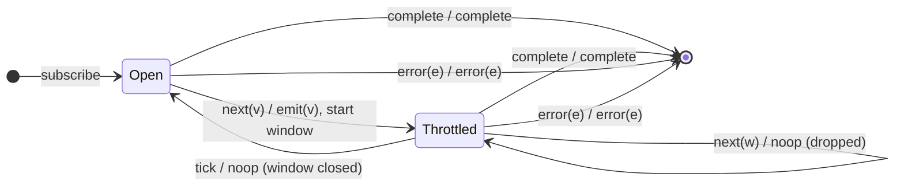

# `throttleTime` as a Mealy Machine

> `throttleTime(d)` emits the first value immediately (the **leading** edge),
> then ignores subsequent source values for `d` milliseconds, then is ready to
> emit the next arriving value again. It is the dual of `debounceTime`: debounce
> waits for silence, throttle enforces a minimum spacing. Analysed here with the
> **default config** `{ leading: true, trailing: false }`.

Signature:

```ts
throttleTime<V>(duration: number, scheduler?, config = { leading: true, trailing: false })
```

---

## 1. Time as an input symbol (again)

As with `debounceTime`, we add an internal symbol:

- `tick` — "the throttle window that was opened `d` ms ago has now closed".

The crucial difference from debounce: `throttleTime` arms its timer on the
**emit** (leading edge), and the timer firing does **not** itself emit anything
in the default config — it merely re-opens the gate.

---

## 2. The 6-Tuple  M = (Q, Σ, Λ, δ, λ, q₀)

### Q — States

- `Open` — the gate is open; the next source value will be emitted immediately.
- `Throttled(until)` — inside a throttle window; source values are ignored. The
  window closes at time `until`.
- `Done` — terminal.

> With the default `trailing: false` there is **no** pending value stored during
> the throttle window — ignored values are simply discarded. (If `trailing:
> true`, we would need a `Throttled(v, until)` state carrying the last-seen
> value to flush on `tick`. See note at the end.)

### Σ — Input alphabet

- `next(v)` — source value.
- `tick` — throttle window closes (internal).
- `complete`
- `error(e)`

### Λ — Output alphabet

- `emit(v)`
- `complete`
- `error(e)`
- `noop`

### δ, λ — Transition & Output

The defining Mealy edges:

1. `Open --next(v)--> Throttled(now+d) / emit(v)` — leading-edge emit, then shut
   the gate. **This is the only edge that emits a value** in the default config.
2. `Throttled --next(w)--> Throttled / noop` — value arrives during the window;
   dropped.
3. `Throttled --tick--> Open / noop` — window closes; gate re-opens. No emission
   (default `trailing: false`).

### q₀ — Initial state

`q₀ = Open`.

---

## 3. State Transition Table (STT)

| #  | Current state     | Input (Σ)   | Guard   | Next state (δ)        | Output (λ)   |
|----|-------------------|-------------|---------|-----------------------|--------------|
| 1  | `Open`            | `next(v)`   | —       | `Throttled(now+d)`    | `emit(v)`    |
| 2  | `Throttled(u)`    | `next(w)`   | —       | `Throttled(u)`        | `noop`       |
| 3  | `Throttled(u)`    | `tick`      | window closed | `Open`          | `noop`       |
| 4  | `Open`            | `complete`  | —       | `Done`                | `complete`   |
| 5  | `Throttled(u)`    | `complete`  | —       | `Done`                | `complete`   |
| 6  | `Open`/`Throttled`| `error(e)`  | —       | `Done`                | `error(e)`   |
| 7  | `Done`            | any         | —       | `Done`                | `noop`       |

> Compare with debounce's STT: there, the *timer firing* emits (row 3 emits);
> here, the *first value* emits (row 1 emits) and the timer firing is silent
> (row 3 is `noop`). That inversion is the whole leading-vs-trailing story.

---

## 4. State Transition Diagram (STD)



---

## 5. From STT rows to test cases

| STT row | Test name                                                       |
|---------|-----------------------------------------------------------------|
| 1       | first value passes immediately (leading edge)                   |
| 2       | values inside the window are dropped                            |
| 3 + 1   | after the window closes, the next value emits again             |
| 4/5     | completion is forwarded (from either gate state)                |
| 6       | error is forwarded                                              |

See `tests/04-throttleTime.test.ts`.

---

## Note on `trailing: true`

With `{ leading: true, trailing: true }` (or `leading:false, trailing:true`),
the throttle window must remember the **last** value seen while throttled and
emit it on `tick`. That promotes the state to `Throttled(v, until)` and changes
row 3 to `Throttled(v,u) --tick--> Open / emit(v)` — structurally merging in the
debounce-style "timer emits" edge. The 6-tuple method makes this configuration
difference explicit: it adds a value parameter to the throttled state and an
output to the tick edge.
