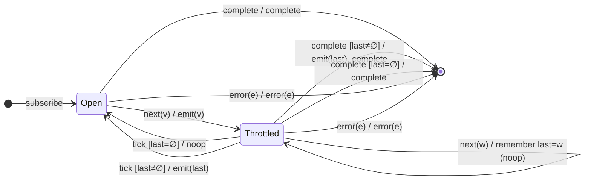

# `throttleTime(d, scheduler, { trailing: true })` as a Mealy Machine

> This is the configuration variant promised in `docs/04-throttleTime.md`. With
> `trailing: true` the operator must **remember the last value seen while
> throttled** and emit it when the window closes. That promotes the throttled
> state to carry a value and adds an **emit on the `tick` edge** — the exact
> debounce-style edge that the default (`trailing: false`) config lacked.

Config analysed: `{ leading: true, trailing: true }` (both edges). Notes at the
end cover `{ leading: false, trailing: true }`.

---

## 1. What changes versus the default config

| Aspect                       | `trailing: false` (doc 04) | `trailing: true` (this doc)      |
|------------------------------|----------------------------|----------------------------------|
| Throttled state              | `Throttled(until)`         | `Throttled(until, last?)`        |
| Value seen while throttled   | dropped                    | **remembered** as `last`         |
| `tick` edge output           | `noop`                     | `emit(last)` **if** a `last` exists |
| Emits per window             | 1 (the leading value)      | up to 2 (leading + trailing)     |

So the single structural change is: the throttled state gains an **optional
pending slot**, and the timer edge gains an **output**.

---

## 2. The 6-Tuple  M = (Q, Σ, Λ, δ, λ, q₀)

### Q — States

- `Open` — gate open; next value emits immediately (leading edge).
- `Throttled(last?)` — inside the window; `last` holds the most recent value
  seen during the window (or ∅ if none yet).
- `Done` — terminal.

### Σ — Input alphabet

`next(v)`, `tick` (window closes), `complete`, `error(e)`.

### Λ — Output alphabet

`emit(v)`, `complete`, `error(e)`, `noop`.

### δ, λ — Transition & Output

Two emit edges now (vs. one in the default config):

1. **Leading:** `Open --next(v)--> Throttled(∅) / emit(v)`.
2. **Trailing:** `Throttled(last) --tick [last ≠ ∅]--> Open / emit(last)`, which
   *also re-opens* and — because a trailing emit itself re-starts a window in
   RxJS — may immediately re-enter `Throttled`. For the marble-level model we
   treat the trailing emit as the window-close output.

### q₀ — Initial state

`q₀ = Open`.

---

## 3. State Transition Table (STT)

| #  | Current state       | Input (Σ)   | Guard         | Next state (δ)        | Output (λ)   |
|----|---------------------|-------------|---------------|-----------------------|--------------|
| 1  | `Open`              | `next(v)`   | —             | `Throttled(∅)`        | `emit(v)`    |
| 2  | `Throttled(last)`   | `next(w)`   | —             | `Throttled(w)`        | `noop`       |
| 3  | `Throttled(last)`   | `tick`      | `last = ∅`    | `Open`                | `noop`       |
| 4  | `Throttled(last)`   | `tick`      | `last ≠ ∅`    | `Open` (re-armed)     | `emit(last)` |
| 5  | `Open`              | `complete`  | —             | `Done`                | `complete`   |
| 6  | `Throttled(last)`   | `complete`  | `last ≠ ∅`    | `Done`                | `emit(last)` **at window close**, then `complete` |
| 7  | `Throttled(last)`   | `complete`  | `last = ∅`    | `Done`                | `complete`   |
| 8  | any                 | `error(e)`  | —             | `Done`                | `error(e)`   |
| 9  | `Done`              | any         | —             | `Done`                | `noop`       |

> Rows 3 vs 4 are the guarded fork on the `tick` edge — the heart of the
> trailing behaviour. Rows 6/7 are the completion analogue: a pending trailing
> value is flushed on complete.

---

## 4. State Transition Diagram (STD)

---

## 5. From STT rows to test cases

| STT row | Test name                                                           |
|---------|---------------------------------------------------------------------|
| 1       | leading value still emits immediately                               |
| 1+2+4   | a value seen during the window is emitted at window close (trailing)|
| 3       | window with no trailing value closes silently                       |
| 6       | completion flushes a pending trailing value                         |
| 8       | error forwarded (pending trailing dropped)                          |

See `tests/05-throttleTime-trailing.test.ts`. The marble timing of the trailing
emit is confirmed empirically by the TestScheduler (as always, the runner is the
oracle for exact frames).

### Discovered asymmetry with `debounceTime` (oracle-confirmed)

A subtle but important difference the test runner surfaced:

- `debounceTime` **short-circuits on complete** — a pending value is flushed
  *immediately* at the completion frame (see `docs/03`, Row 5).
- `throttleTime({ trailing: true })` does **not** short-circuit — when the
  source completes mid-window with a pending trailing value, the operator still
  **waits for the window to close** and emits the trailing value *there* (frame
  = window close), then completes.

So Row 6's output lands at the window-close frame, not the completion frame.
Two time-based operators, two different completion policies — exactly the kind
of behavioural edge the STT-per-row test methodology is designed to pin down.
