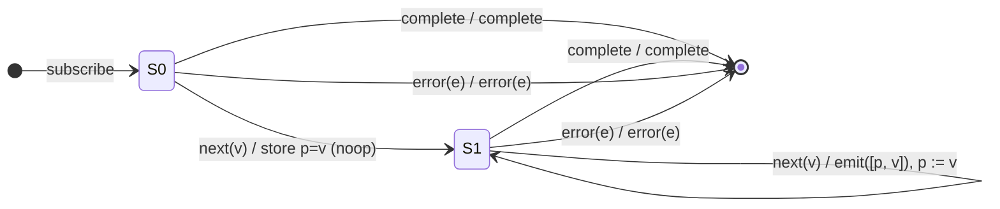

# `pairwise` as a Mealy Machine

> `pairwise()` groups consecutive source values into overlapping pairs: it emits
> `[previous, current]` for every value **except the first** (which has no
> predecessor). N source values produce N−1 pairs.

Signature:

```ts
pairwise<V>(): OperatorFunction<V, [V, V]>
```

---

## 1. The 6-Tuple  M = (Q, Σ, Λ, δ, λ, q₀)

### Q — States

A textbook **two-state bootstrap**:

- `S0` — no value seen yet (no predecessor available).
- `S1(p)` — holding the previous value `p`, ready to pair it with the next.
- `Done` — terminal.

### Σ — Input alphabet

`next(v)`, `complete`, `error(e)`.

### Λ — Output alphabet

- `emit([p, v])` — a pair.
- `complete`, `error(e)`, `noop`.

### δ, λ — Transition & Output

The bootstrap edge swallows the first value (no output); every later value
produces exactly one pair:

1. `S0 --next(v)--> S1(v) / noop` — store first value, emit nothing.
2. `S1(p) --next(v)--> S1(v) / emit([p, v])` — emit the pair, slide the window.

### q₀ — Initial state

`q₀ = S0`.

---

## 2. State Transition Table (STT)

| #  | Current state | Input (Σ)   | Next state (δ) | Output (λ)       |
|----|---------------|-------------|----------------|------------------|
| 1  | `S0`          | `next(v)`   | `S1(v)`        | `noop` (bootstrap)|
| 2  | `S1(p)`       | `next(v)`   | `S1(v)`        | `emit([p, v])`   |
| 3  | `S0`          | `complete`  | `Done`         | `complete`       |
| 4  | `S1(p)`       | `complete`  | `Done`         | `complete`       |
| 5  | any           | `error(e)`  | `Done`         | `error(e)`       |
| 6  | `Done`        | any         | `Done`         | `noop`           |

> Row 1 is the bootstrap that makes `pairwise` emit N−1 pairs instead of N. It
> is structurally the same `S0 → S1` edge as `distinctUntilChanged`, except the
> output is suppressed rather than forwarded, and the state carries `p` for use
> in the *next* transition's output (pure Mealy: output depends on both the
> stored state `p` and the incoming `v`).

---

## 3. State Transition Diagram (STD)



---

## 4. From STT rows to test cases

| STT row | Test name                                                 |
|---------|-----------------------------------------------------------|
| 1       | first value produces no output (bootstrap swallow)        |
| 2       | each subsequent value emits [prev, curr]; sliding window  |
| 3       | single-value source completes with no pair                |
| 4       | completion forwarded after pairs                          |
| 5       | error forwarded from either state                         |

See `tests/06-pairwise.test.ts`.
