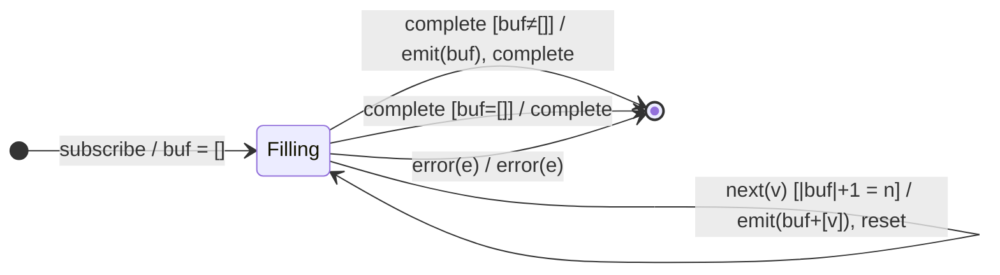

# `bufferCount(n)` as a Mealy Machine

> `bufferCount(bufferSize, startBufferEvery?)` collects source values into
> arrays and emits an array once it holds `bufferSize` values, then starts a
> fresh buffer. On completion it flushes any partial buffer. This analysis
> covers the **single-arg** form `bufferCount(n)`; the sliding/overlapping
> `startBufferEvery` form is noted at the end.

Signature:

```ts
bufferCount<V>(bufferSize: number, startBufferEvery?: number | null)
```

---

## 1. The 6-Tuple  M = (Q, Σ, Λ, δ, λ, q₀)

### Q — States

The state is the **current buffer**, which is equivalent to a counter modulo
`n` plus the collected values:

- `Filling(buf)` — accumulating; `buf` is the array so far, with
  `0 ≤ |buf| < n`.
- `Done` — terminal.

Conceptually the operative part of the state is `|buf| mod n`: output fires
precisely when the count rolls over to `n`.

### Σ — Input alphabet

`next(v)`, `complete`, `error(e)`.

### Λ — Output alphabet

- `emit(arr)` — flush a buffer array.
- `complete`, `error(e)`, `noop`.

### δ, λ — Transition & Output

The Mealy fork is on the **guard** `|buf| + 1 = n`:

1. **Below boundary:** `Filling(buf) --next(v) [|buf|+1 < n]--> Filling(buf+[v])
   / noop`.
2. **At boundary:** `Filling(buf) --next(v) [|buf|+1 = n]--> Filling([])
   / emit(buf+[v])` — flush the completed buffer and reset.

### q₀ — Initial state

`q₀ = Filling([])`.

---

## 2. State Transition Table (STT)

| #  | Current state   | Input (Σ)   | Guard              | Next state (δ)        | Output (λ)        |
|----|-----------------|-------------|--------------------|-----------------------|-------------------|
| 1  | `Filling(buf)`  | `next(v)`   | `|buf|+1 < n`      | `Filling(buf+[v])`    | `noop`            |
| 2  | `Filling(buf)`  | `next(v)`   | `|buf|+1 = n`      | `Filling([])`         | `emit(buf+[v])`   |
| 3  | `Filling(buf)`  | `complete`  | `buf ≠ []`         | `Done`                | `emit(buf)`, `complete` |
| 3b | `Filling([])`   | `complete`  | `buf = []`         | `Done`                | `complete` (no empty buffer) |
| 4  | `Filling(buf)`  | `error(e)`  | —                  | `Done`                | `error(e)` (buf dropped) |
| 5  | `Done`          | any         | —                  | `Done`                | `noop`            |

> Row 2 is the **modulo-boundary flush**. Row 3 is the partial-buffer flush on
> completion (RxJS emits the leftover values); Row 3b confirms an *empty* buffer
> is **not** emitted. Row 4 shows error discards the partial buffer.

---

## 3. State Transition Diagram (STD)



---

## 4. From STT rows to test cases

| STT row | Test name                                                  |
|---------|------------------------------------------------------------|
| 1 + 2   | emits a buffer of n and resets (modulo boundary)           |
| 3       | partial buffer flushed on completion                       |
| 3b      | empty source completes with no buffer                      |
| 2 exact | exact multiple -> no empty trailing buffer                 |
| 4       | error forwarded, partial buffer dropped                    |
| n=1     | degenerate: every value is its own singleton buffer        |

See `tests/07-bufferCount.test.ts`.

---

## Note on `startBufferEvery` (overlapping / sliding buffers)

With `bufferCount(n, m)` a new buffer starts every `m` values:

- `m < n` → **overlapping** buffers (a value can appear in several buffers). The
  state must hold *multiple* in-flight buffers at different fill levels — i.e. a
  queue of `Filling` arrays, each with its own counter. The STT gains a row for
  "start a new buffer every m-th value".
- `m > n` → **gaps** (some values dropped between buffers), modeled by a
  `Skipping(k)` state counting discarded values.

Either way the single-counter state generalizes to a *set of counters*, which is
the natural Mealy extension.
