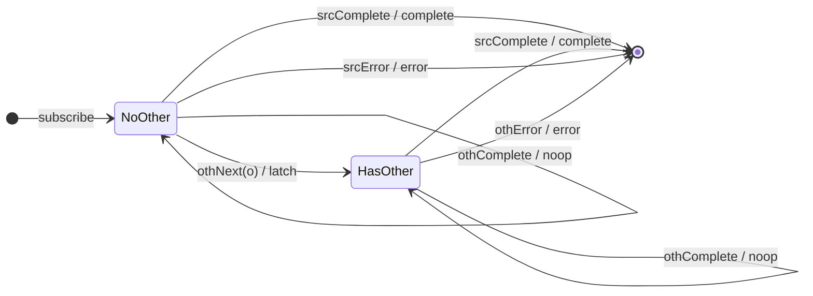

# `withLatestFrom` as a Mealy Machine

> `withLatestFrom(other)` emits, for each **source** value, a combination of
> that value with the **latest** value from `other`. The source drives emission;
> `other` only contributes its most recent value (a "sampled" input). If `other`
> has not yet emitted when a source value arrives, **nothing is emitted** for
> that source value.

Signature (single other, default array projection):

```ts
withLatestFrom<V, O>(other: ObservableInput<O>): OperatorFunction<V, [V, O]>
```

This is a genuine step up: **two input alphabets** feed one machine.

---

## 1. Two input alphabets

Unlike every operator so far, `withLatestFrom` subscribes to **two** streams.
We tag each notification with its origin:

- From the **source** (primary): `srcNext(v)`, `srcComplete`, `srcError(e)`.
- From **other** (secondary): `othNext(o)`, `othComplete`, `othError(e)`.

The combined input alphabet is Σ = Σ_src ∪ Σ_oth. The two streams are
asynchronous, so the machine's job is to remember `other`'s latest value and
combine it on each source emission.

---

## 2. The 6-Tuple  M = (Q, Σ, Λ, δ, λ, q₀)

### Q — States

The memory is "do we have a latest `other` value yet, and what is it":

- `NoOther` — `other` has not emitted yet; source values cannot be combined.
- `HasOther(o)` — `other`'s latest value is `o`.
- `Done` — terminal.

### Σ — Input alphabet

`srcNext(v)`, `othNext(o)`, `srcComplete`, `othComplete`, `srcError`, `othError`.

### Λ — Output alphabet

- `emit([v, o])` — source value combined with latest other.
- `complete`, `error(e)`, `noop`.

### δ, λ — Transition & Output

Key edges:

1. `NoOther --srcNext(v)--> NoOther / noop` — no `other` yet, source value is
   **dropped** (not buffered).
2. `othNext(o)` (any state) `--> HasOther(o) / noop` — latch the latest other,
   emit nothing by itself.
3. `HasOther(o) --srcNext(v)--> HasOther(o) / emit([v, o])` — the combine edge.

Termination asymmetry:

4. `srcComplete` → `Done / complete` — **source completing completes the
   output.**
5. `othComplete` → stay / `noop` — **other completing does NOT complete the
   output** (its latest value remains usable). This asymmetry is the crux.

### q₀ — Initial state

`q₀ = NoOther`.

---

## 3. State Transition Table (STT)

| #  | Current state | Input (Σ)     | Next state (δ)      | Output (λ)        |
|----|---------------|---------------|---------------------|-------------------|
| 1  | `NoOther`     | `srcNext(v)`  | `NoOther`           | `noop` (dropped)  |
| 2  | `NoOther`     | `othNext(o)`  | `HasOther(o)`       | `noop` (latch)    |
| 3  | `HasOther(o)` | `othNext(o')` | `HasOther(o')`      | `noop` (update)   |
| 4  | `HasOther(o)` | `srcNext(v)`  | `HasOther(o)`       | `emit([v, o])`    |
| 5  | any           | `srcComplete` | `Done`              | `complete`        |
| 6  | any           | `othComplete` | (unchanged)         | `noop`            |
| 7  | any           | `srcError(e)` | `Done`              | `error(e)`        |
| 8  | any           | `othError(e)` | `Done`              | `error(e)`        |
| 9  | `Done`        | any           | `Done`              | `noop`            |

> Rows 1 vs 4 are the same source input (`srcNext`) forked by which state we are
> in — that is where "has other emitted yet?" is decided. Rows 5 vs 6 encode the
> **completion asymmetry**: source drives completion, other does not. Rows 7/8
> show an error on *either* stream terminates the output.

---

## 4. State Transition Diagram (STD)



---

## 5. From STT rows to test cases

| STT row | Test name                                                       |
|---------|-----------------------------------------------------------------|
| 1       | source value before other emits is dropped                      |
| 2+4     | once other has latched, source values combine with latest other |
| 3       | other updating changes which value gets combined next           |
| 5       | source completing completes the output                          |
| 6       | other completing does NOT complete the output (asymmetry)       |
| 7/8     | error on either stream terminates                               |

See `tests/08-withLatestFrom.test.ts`. Marble tests use a `hot`/`cold` source
plus a second marble stream for `other`, exercising the interleaving explicitly.
