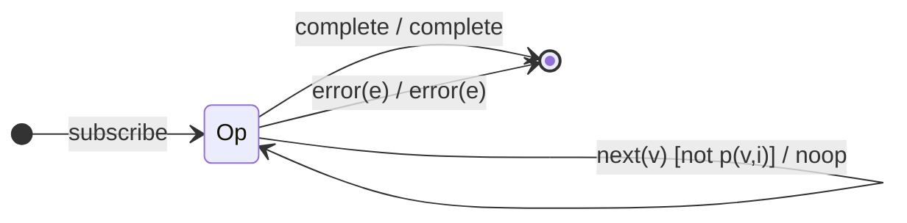

# Session 3 — The Transformation Family as Mealy Machines

> 12 operators that transform the value stream. They split into four sub-shapes
> of Mealy machine, from the trivial single-state projector to the
> notification-reifying `materialize`/`dematerialize` pair.
>
> **This file is the family overview.** Each operator also has its own dedicated
> analysis in [`docs/operators/`](operators/README.md):
> [`map`](operators/map.md) · [`mapTo`](operators/mapTo.md) ·
> [`pluck`](operators/pluck.md) · [`filter`](operators/filter.md) ·
> [`tap`](operators/tap.md) · [`scan` seedless](operators/scan-seedless.md) ·
> [`reduce`](operators/reduce.md) · [`mergeScan`](operators/mergeScan.md) ·
> [`switchScan`](operators/switchScan.md) · [`partition`](operators/partition.md) ·
> [`materialize`](operators/materialize.md) · [`dematerialize`](operators/dematerialize.md).

Operators covered:

| Sub-family        | Operators                                             |
|-------------------|-------------------------------------------------------|
| Stateless project | `map`, `mapTo`, `pluck`, `filter`, `tap`              |
| Accumulators      | `scan` (seedless revisit), `reduce`                   |
| Higher-order acc. | `mergeScan`, `switchScan`                             |
| Split & reify     | `partition`, `materialize`, `dematerialize`           |

A recurring theme: most of these are **single-state** machines (one operational
state `Op`), because they keep no memory between notifications. That is the
defining mark of a *stateless transformation* — and in Mealy terms it means
`δ(Op, next) = Op` always, with all the interest living in the output function
`λ`.

---

## Sub-family A — Stateless projectors (`map`, `mapTo`, `pluck`, `filter`, `tap`)

### Shared shape

- **Q** = `{ Op, Done }` — a single operational state plus terminal.
- **Σ** = `{ next(v), complete, error(e) }`.
- **Λ** = `{ emit(x), complete, error(e), noop }`.
- **q₀** = `Op`.
- **δ**: `Op --next--> Op`; any terminal → `Done`.

They differ **only in the output function λ** on the `next` edge:

| Operator  | λ on `Op --next(v)-->`                      | Notes |
|-----------|---------------------------------------------|-------|
| `map(f)`  | `emit(f(v, i))`                             | index `i` threaded |
| `mapTo(c)`| `emit(c)`                                   | literally `map(() => c)` in v7 |
| `pluck(k)`| `emit(v?.[k])` (nested keys walk the path)  | literally `map` over a key path in v7; `undefined` if missing |
| `filter(p)`| `emit(v)` if `p(v,i)` else `noop`          | the only guarded one |
| `tap(o)`  | run side-effect `o.next(v)`, then `emit(v)` | value passes through unchanged |

> `mapTo` and `pluck` are implemented *as* `map` in RxJS 7 — their STTs are
> `map`'s STT with a specialized `f`. `tap` is a `map` whose projection is
> identity but with an observer side-effect on the edge; crucially `tap` also
> has edges for the terminal notifications (it can observe `complete`/`error`).

### STT (map — representative)

| # | State | Input       | Guard | Next | Output          |
|---|-------|-------------|-------|------|-----------------|
| 1 | `Op`  | `next(v)`   | —     | `Op` | `emit(f(v, i))` |
| 2 | `Op`  | `complete`  | —     | `Done`| `complete`     |
| 3 | `Op`  | `error(e)`  | —     | `Done`| `error(e)`     |

### STT (filter — adds a guard fork on row 1)

| # | State | Input     | Guard         | Next | Output   |
|---|-------|-----------|---------------|------|----------|
| 1 | `Op`  | `next(v)` | `p(v,i)=true` | `Op` | `emit(v)`|
| 2 | `Op`  | `next(v)` | `p(v,i)=false`| `Op` | `noop`   |
| 3 | `Op`  | `complete`| —             | `Done`| `complete`|
| 4 | `Op`  | `error(e)`| —             | `Done`| `error(e)`|

### STD (filter)

### `tap` — side-effects on every edge

`tap` is the one projector that reacts to **all** of Σ (not just `next`): it can
fire observer callbacks on `next`, `complete`, and `error`, and still forwards
each notification unchanged. Its STT is `map`'s identity STT with an added
"run side-effect" annotation on every edge, and a guarantee that `λ` forwards
the *original* value/notification (never a transformed one).

---

## Sub-family B — Accumulators (`scan` seedless, `reduce`)

`scan` (seeded) was done in Session 1. Two variants complete the picture.

### `scan` without a seed

Adds a bootstrap state: the **first value becomes the accumulator** and is
emitted unchanged.

- **Q** = `{ Fresh, Running(acc, i), Done }`, `q₀ = Fresh`.

| # | State            | Input      | Next state           | Output              |
|---|------------------|------------|----------------------|---------------------|
| 1 | `Fresh`          | `next(v)`  | `Running(v, 1)`      | `emit(v)` (seed=v)  |
| 2 | `Running(acc,i)` | `next(v)`  | `Running(f(acc,v,i), i+1)` | `emit(f(acc,v,i))` |
| 3 | any              | `complete` | `Done`               | `complete`          |
| 4 | any              | `error(e)` | `Done`               | `error(e)`          |

This is the same bootstrap shape as `pairwise`/`distinctUntilChanged` (`S0 → S1`).

### `reduce` — "emit only on complete"

`reduce` is `scan` that **suppresses** every intermediate emission and emits a
**single** final value on completion. In RxJS 7 both share `scanInternals`; the
distinguishing flag is "emitOnNext = false, emitBeforeComplete = true".

- **Q** = `{ Accum(acc, i, seen), Done }`.

| # | State                 | Input      | Guard          | Next state          | Output                 |
|---|-----------------------|------------|----------------|---------------------|------------------------|
| 1 | `Accum(acc,i,seen)`   | `next(v)`  | —              | `Accum(f(acc,v,i), i+1, true)` | `noop` (accumulate silently) |
| 2 | `Accum(acc,_,true)`   | `complete` | has seed or seen | `Done`            | `emit(acc)`, `complete`|
| 3 | `Accum(_,_,false)`    | `complete` | no seed, nothing seen | `Done`       | `error` (EmptyError-like)? → actually `complete` with no value unless seedless+empty |
| 4 | any                   | `error(e)` | —              | `Done`              | `error(e)`             |

> The seedless-and-empty case: `reduce` with no seed over an empty source
> completes **without emitting** (it does not throw). With a seed, an empty
> source emits the seed. The tests pin both.

Contrast with `scan`: scan's row 1 **emits**, reduce's row 1 is **noop**. Same
state machine shape, inverted output policy — a clean illustration of the Mealy
principle that *output lives on the edge*, independent of the state structure.

---

## Sub-family C — Higher-order accumulators (`mergeScan`, `switchScan`)

These are `scan` where the accumulator returns an **inner Observable** rather
than a plain value; the operator subscribes to it and feeds its emissions back
as the next accumulator. So the state gains **inner-subscription bookkeeping**.

### `mergeScan(acc, seed, concurrent?)`

- **Q** = `{ Scanning(acc, actives), Done }` where `actives` is the set of
  in-flight inner subscriptions (bounded by `concurrent`).
- On `next(v)`: call `acc(state, v)` → inner observable; subscribe (or buffer if
  at the concurrency limit). Each inner `next(r)` updates `state := r` **and**
  `emit(r)`.
- Completion waits for the source **and** all inners to finish.

| # | State                 | Input (Σ+inner)   | Next state                 | Output     |
|---|-----------------------|-------------------|----------------------------|------------|
| 1 | `Scanning(s, A)`      | `next(v)`         | subscribe inner; `A ∪ {i}` | `noop`     |
| 2 | `Scanning(s, A)`      | `innerNext(r)`    | `Scanning(r, A)`           | `emit(r)`  |
| 3 | `Scanning(s, A)`      | `innerComplete(i)`| `A \ {i}`                  | `noop`     |
| 4 | `Scanning(s, {})`     | `srcComplete`     | `Done` (if A empty)        | `complete` |
| 5 | any                   | `error(e)`        | `Done`                     | `error(e)` |

### `switchScan(acc, seed)`

Like `mergeScan` with concurrency 1 **and switch semantics**: a new source value
**unsubscribes the previous inner** before subscribing the new one.

| # | State              | Input           | Next state            | Output     |
|---|--------------------|-----------------|-----------------------|------------|
| 1 | `Scanning(s, cur?)`| `next(v)`       | unsubscribe `cur`; new inner from `acc(s,v)` | `noop` |
| 2 | `Scanning(s, cur)` | `innerNext(r)`  | `Scanning(r, cur)`    | `emit(r)`  |
| 3 | `Scanning(s, cur)` | `innerComplete` | `Scanning(s, ∅)`      | `noop`     |
| 4 | `Scanning(s, ∅)`   | `srcComplete`   | `Done`                | `complete` |
| 5 | any                | `error(e)`      | `Done`                | `error(e)` |

> The difference between merge/switch/concat/exhaust *scan* mirrors the four
> flattening policies covered fully in Session 6. Here we only need the scan
> flavour: state carries the accumulator **and** the inner bookkeeping.

---

## Sub-family D — Split & reify (`partition`, `materialize`, `dematerialize`)

### `partition(predicate)`

Not a single-output operator: it returns **a tuple of two Observables**
`[pass, fail]`. It is `[filter(p), filter(not p)]` over the same source. As a
machine it is **two parallel `filter` machines** sharing one input: on `next(v)`,
exactly one of the two outputs emits (the other `noop`s), decided by the guard.

| # | State | Input     | Guard         | pass output | fail output |
|---|-------|-----------|---------------|-------------|-------------|
| 1 | `Op`  | `next(v)` | `p(v,i)=true` | `emit(v)`   | `noop`      |
| 2 | `Op`  | `next(v)` | `p(v,i)=false`| `noop`      | `emit(v)`   |
| 3 | `Op`  | `complete`| —             | `complete`  | `complete`  |
| 4 | `Op`  | `error(e)`| —             | `error(e)`  | `error(e)`  |

> Both branches complete/error together. This is the first operator whose Λ is a
> **pair of channels**, a mini-preview of the multi-output window operators.

### `materialize` — Σ becomes Λ values

`materialize` turns every source **notification** into a `Notification` object
emitted as a plain `next`, and then completes. It is the operator that most
literally exposes the input alphabet as output *data*.

- **Q** = `{ Op, Done }`, `q₀ = Op`.

| # | State | Input      | Next  | Output                                   |
|---|-------|------------|-------|------------------------------------------|
| 1 | `Op`  | `next(v)`  | `Op`  | `emit(Notification 'N' v)`               |
| 2 | `Op`  | `complete` | `Done`| `emit(Notification 'C')`, then `complete`|
| 3 | `Op`  | `error(e)` | `Done`| `emit(Notification 'E' e)`, then `complete` (NOT error!) |

> The striking edge is row 3: a source **error** is reified into a *next* value
> and the output **completes normally**. `materialize` never errors downstream.

### `dematerialize` — Λ values become Σ again

The inverse: it reads `Notification` objects arriving as `next` and replays them
as real notifications.

| # | State | Input (a Notification n)   | Guard        | Next  | Output        |
|---|-------|----------------------------|--------------|-------|---------------|
| 1 | `Op`  | `next(n)`, `n.kind = 'N'`  | —            | `Op`  | `emit(n.value)`|
| 2 | `Op`  | `next(n)`, `n.kind = 'C'`  | —            | `Done`| `complete`    |
| 3 | `Op`  | `next(n)`, `n.kind = 'E'`  | —            | `Done`| `error(n.error)`|
| 4 | `Op`  | `complete` (source)        | —            | `Done`| `complete`    |

> `materialize` then `dematerialize` is the identity on a stream — a satisfying
> round-trip that the tests verify directly.

---

## From STT rows to test cases

Every operator above has its own test file (`tests/09-*.test.ts` …
`tests/20-*.test.ts`), each `it(...)` annotated with the STT row it exercises.
The guarded operators (`filter`, `partition`) get explicit guard-true and
guard-false cases; `materialize`/`dematerialize` get the error-reification edge
and a round-trip identity test.
