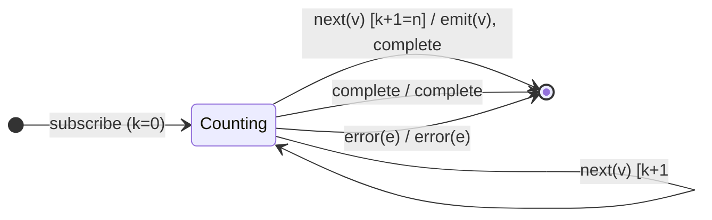

# Session 4 — Filtering & Conditional Emission as Mealy Machines

> 14 operators that decide **whether** and **how many** source values reach the
> output. This is the "counting FSM" session: `take(n)` is the canonical counter
> machine, and `takeUntil`/`skipUntil` reintroduce a **notifier input symbol**
> (a second stream, as in Session 2's `withLatestFrom`).
>
> **This file is the family overview.** Each operator also has its own dedicated
> analysis in [`docs/operators/`](operators/README.md):
> [`take`](operators/take.md) · [`takeLast`](operators/takeLast.md) ·
> [`takeWhile`](operators/takeWhile.md) · [`takeUntil`](operators/takeUntil.md) ·
> [`skip`](operators/skip.md) · [`skipLast`](operators/skipLast.md) ·
> [`skipWhile`](operators/skipWhile.md) · [`skipUntil`](operators/skipUntil.md) ·
> [`first`](operators/first.md) · [`last`](operators/last.md) ·
> [`elementAt`](operators/elementAt.md) · [`single`](operators/single.md) ·
> [`ignoreElements`](operators/ignoreElements.md) ·
> [`defaultIfEmpty`](operators/defaultIfEmpty.md).

Operators covered:

| Sub-family            | Operators                                               |
|-----------------------|---------------------------------------------------------|
| Counting prefixes     | `take`, `skip`, `takeLast`, `skipLast`                  |
| Predicate-gated       | `takeWhile`, `skipWhile`, `filter`-recap (see S3)       |
| Notifier-driven       | `takeUntil`, `skipUntil`                                |
| Selection / existence | `first`, `last`, `elementAt`, `single`, `ignoreElements`, `defaultIfEmpty` |

Common alphabet unless noted:

- **Σ** = `{ next(v), complete, error(e) }` (+ `notifierNext` for the `*Until`
  pair).
- **Λ** = `{ emit(x), complete, error(e), noop }`.

---

## Sub-family A — Counting prefixes

### `take(n)` — the canonical counter

Emit the first `n` values, then complete. `n ≤ 0` ⇒ emit nothing, complete
immediately.

- **Q** = `{ Counting(k) : 0 ≤ k < n, Done }`, `q₀ = Counting(0)` (or `Done` if
  `n ≤ 0`). `k` = how many have been emitted.

| # | State        | Input      | Guard      | Next state       | Output              |
|---|--------------|------------|------------|------------------|---------------------|
| 1 | `Counting(k)`| `next(v)`  | `k+1 < n`  | `Counting(k+1)`  | `emit(v)`           |
| 2 | `Counting(k)`| `next(v)`  | `k+1 = n`  | `Done`           | `emit(v)`, `complete` (self-complete!) |
| 3 | `Counting(k)`| `complete` | —          | `Done`           | `complete`          |
| 4 | `Counting(k)`| `error(e)` | —          | `Done`           | `error(e)`          |

> Row 2 is the defining edge: on the `n`-th value `take` **emits and completes
> in the same step** (and unsubscribes upstream). That self-completion is the
> whole point of the counter.

### `skip(n)` — the mirror counter

Discard the first `n` values, then pass everything through.

- **Q** = `{ Skipping(k) : 0 ≤ k < n, Passing, Done }`, `q₀ = Skipping(0)`
  (or `Passing` if `n ≤ 0`).

| # | State         | Input      | Guard     | Next state      | Output   |
|---|---------------|------------|-----------|-----------------|----------|
| 1 | `Skipping(k)` | `next(v)`  | `k+1 < n` | `Skipping(k+1)` | `noop`   |
| 2 | `Skipping(k)` | `next(v)`  | `k+1 = n` | `Passing`       | `noop`   |
| 3 | `Passing`     | `next(v)`  | —         | `Passing`       | `emit(v)`|
| 4 | any           | `complete` | —         | `Done`          | `complete`|
| 5 | any           | `error(e)` | —         | `Done`          | `error(e)`|

> `skip` is `take`'s dual: `take` counts emissions then stops; `skip` counts
> suppressions then starts. Note `skip` does **not** self-complete — it runs to
> the source's own completion.

### `takeLast(n)` — buffer-the-tail, emit on complete

Keep a sliding window of the last `n` values; emit them **in order on
completion**. `takeLast(0)` ⇒ `EMPTY`.

- **Q** = `{ Buffering(win), Done }` where `win` is a FIFO of at most `n`.

| # | State            | Input      | Guard        | Next state                    | Output                       |
|---|------------------|------------|--------------|-------------------------------|------------------------------|
| 1 | `Buffering(win)` | `next(v)`  | `|win| < n`  | `Buffering(win++[v])`         | `noop`                       |
| 2 | `Buffering(win)` | `next(v)`  | `|win| = n`  | `Buffering(win[1:]++[v])`     | `noop` (drop oldest)         |
| 3 | `Buffering(win)` | `complete` | —            | `Done`                        | `emit(win[0]) … emit(win[last])`, `complete` |
| 4 | `Buffering(win)` | `error(e)` | —            | `Done`                        | `error(e)` (window dropped)  |

> `takeLast` cannot emit anything until the source completes (it can't know
> which values are "last" until then). Row 3 flushes the whole window
> synchronously at the completion frame.

### `skipLast(n)` — delay-line

Emit everything **except** the final `n`. Implemented as a delay line: emit
`v[i−n]` when `v[i]` arrives (so the last `n` never get their turn).

- **Q** = `{ Filling(ring) : |ring| < n, Flowing(ring) : |ring| = n, Done }`.

| # | State           | Input      | Guard      | Next state              | Output              |
|---|-----------------|------------|------------|-------------------------|---------------------|
| 1 | `Filling(ring)` | `next(v)`  | `|ring|<n` | `Filling(ring++[v])`    | `noop` (priming)    |
| 2 | `Flowing(ring)` | `next(v)`  | `|ring|=n` | `Flowing(ring[1:]++[v])`| `emit(ring[0])`     |
| 3 | any             | `complete` | —          | `Done`                  | `complete` (drop the n still in the ring) |
| 4 | any             | `error(e)` | —          | `Done`                  | `error(e)`          |

---

## Sub-family B — Predicate-gated

### `takeWhile(p, inclusive?)`

Emit while `p(v,i)` holds; on the first failing value, complete. With
`inclusive = true`, also emit that first failing value before completing.

| # | State  | Input      | Guard                    | Next  | Output                        |
|---|--------|------------|--------------------------|-------|-------------------------------|
| 1 | `Open` | `next(v)`  | `p(v,i)=true`            | `Open`| `emit(v)`                     |
| 2 | `Open` | `next(v)`  | `p(v,i)=false`, incl=false | `Done`| `complete`                  |
| 3 | `Open` | `next(v)`  | `p(v,i)=false`, incl=true  | `Done`| `emit(v)`, `complete`       |
| 4 | `Open` | `complete` | —                        | `Done`| `complete`                    |
| 5 | `Open` | `error(e)` | —                        | `Done`| `error(e)`                    |

> **Timing contrast with `take(n)` (oracle-confirmed).** `take(n)` self-completes
> *on the same frame as the n-th emitted value* (Row 2 emits and completes
> together). `takeWhile` **cannot** — it only learns to stop when it *sees* the
> first failing value, so the completion lands on that failing value's frame,
> one notification *after* the last emitted value (in the exclusive case). The
> inclusive case emits the failing value and completes on that same frame.

### `skipWhile(p)`

Discard while `p(v,i)` holds; once it fails **once**, pass everything (including
that value) onward — the predicate is never consulted again.

| # | State        | Input      | Guard         | Next state   | Output   |
|---|--------------|------------|---------------|--------------|----------|
| 1 | `Skipping`   | `next(v)`  | `p(v,i)=true` | `Skipping`   | `noop`   |
| 2 | `Skipping`   | `next(v)`  | `p(v,i)=false`| `Passing`    | `emit(v)`|
| 3 | `Passing`    | `next(v)`  | —             | `Passing`    | `emit(v)`|
| 4 | any          | `complete` | —             | `Done`       | `complete`|
| 5 | any          | `error(e)` | —             | `Done`       | `error(e)`|

> `skipWhile`'s latch (`Skipping → Passing`, one-way) is the predicate analogue
> of `skip(n)`'s counter latch.

---

## Sub-family C — Notifier-driven (second input alphabet)

Both subscribe to a **notifier** observable in addition to the source. New
symbols: `notifierNext(_)`, `notifierComplete`.

### `takeUntil(notifier)`

Pass the source through until the notifier emits (or completes-with-value), then
complete.

| # | State  | Input              | Next  | Output     |
|---|--------|--------------------|-------|------------|
| 1 | `Open` | `srcNext(v)`       | `Open`| `emit(v)`  |
| 2 | `Open` | `notifierNext(_)`  | `Done`| `complete` |
| 3 | `Open` | `srcComplete`      | `Done`| `complete` |
| 4 | `Open` | `srcError(e)`      | `Done`| `error(e)` |
| 5 | `Open` | `notifierError(e)` | `Done`| `error(e)` |

> Row 2 is the cutoff: the **first** notifier `next` completes the output,
> regardless of source state. A notifier that only completes (never emits) does
> **not** cut off the source (it must emit a value).

### `skipUntil(notifier)`

The mirror: **discard** source values until the notifier emits, then pass the
rest.

| # | State       | Input             | Next      | Output   |
|---|-------------|-------------------|-----------|----------|
| 1 | `Gated`     | `srcNext(v)`      | `Gated`   | `noop`   |
| 2 | `Gated`     | `notifierNext(_)` | `Open`    | `noop`   |
| 3 | `Open`      | `srcNext(v)`      | `Open`    | `emit(v)`|
| 4 | any         | `srcComplete`     | `Done`    | `complete`|
| 5 | any         | `*Error(e)`       | `Done`    | `error(e)`|

---

## Sub-family D — Selection / existence

### `first(predicate?, default?)` = `filter(p) → take(1) → (defaultIfEmpty | throwIfEmpty EmptyError)`

- Emits the first matching value and completes.
- No match / empty: emits `default` if supplied, else **errors with
  `EmptyError`**.

### `last(predicate?, default?)` = `filter(p) → takeLast(1) → (defaultIfEmpty | throwIfEmpty EmptyError)`

- Emits the last matching value on completion.
- Same empty policy as `first` (default or `EmptyError`).

### `elementAt(i, default?)` = `filter((_,n) => n===i) → take(1) → (defaultIfEmpty | throwIfEmpty ArgumentOutOfRangeError)`

- Emits the value at index `i`.
- Index out of range: `default` if supplied, else **`ArgumentOutOfRangeError`**.
  `i < 0` throws synchronously.

### `single(predicate?)` — the 4-outcome machine

Needs to see the **whole** source to decide. State counts matches:

- **Q** = `{ Counting(matches, lastMatch?), Done }`.

| # | State                 | Input      | Guard                 | Next                       | Output                         |
|---|-----------------------|------------|-----------------------|----------------------------|--------------------------------|
| 1 | `Counting(0, ∅)`      | `next(v)`  | matches `p`           | `Counting(1, v)`           | `noop`                         |
| 2 | `Counting(1, m)`      | `next(v)`  | matches `p` (2nd!)    | `Done`                     | `error(SequenceError)` — too many |
| 3 | `Counting(c, m)`      | `next(v)`  | not match             | `Counting(c, m)`           | `noop`                         |
| 4 | `Counting(1, m)`      | `complete` | exactly one           | `Done`                     | `emit(m)`, `complete`          |
| 5 | `Counting(0, ∅)`      | `complete` | none, source non-empty| `Done`                     | `error(NotFoundError)`         |
| 6 | `Counting(0, ∅)`      | `complete` | source empty          | `Done`                     | `error(EmptyError)`            |

> `single` is the richest existence machine: three distinct error outcomes plus
> the success case, all decided by a match counter. (RxJS distinguishes empty
> vs. non-empty-but-no-match via whether any value was seen at all.)

### `ignoreElements()` — swallow all values, keep terminals

| # | State  | Input      | Next  | Output     |
|---|--------|------------|-------|------------|
| 1 | `Op`   | `next(v)`  | `Op`  | `noop`     |
| 2 | `Op`   | `complete` | `Done`| `complete` |
| 3 | `Op`   | `error(e)` | `Done`| `error(e)` |

> The purest "λ = noop on next" machine — it keeps only the completion/error
> channel. Dual of `materialize` in spirit: materialize keeps *everything* as
> data; ignoreElements keeps *nothing but* the terminal.

### `defaultIfEmpty(d)`

| # | State        | Input      | Guard      | Next         | Output              |
|---|--------------|------------|------------|--------------|---------------------|
| 1 | `Empty`      | `next(v)`  | —          | `Seen`       | `emit(v)`           |
| 2 | `Seen`       | `next(v)`  | —          | `Seen`       | `emit(v)`           |
| 3 | `Empty`      | `complete` | never saw  | `Done`       | `emit(d)`, `complete` |
| 4 | `Seen`       | `complete` | saw ≥1     | `Done`       | `complete`          |
| 5 | any          | `error(e)` | —          | `Done`       | `error(e)`          |

> The `Empty → Seen` latch is a one-bit memory; the default fires only on the
> completion edge out of `Empty`. (`throwIfEmpty` is identical but row 3 emits
> `error(EmptyError)` instead of the default — hence it is the engine behind
> `first`/`last`/`elementAt`'s empty policy.)

---

## From STT rows to test cases

Each operator has a test file (`tests/21-*` … `tests/34-*`), every `it(...)`
annotated with its STT row. Guarded operators get guard-true/false pairs;
`take`/`skip`/`takeLast`/`skipLast` get `n = 0` and `n > length` boundary cases;
`first`/`last`/`elementAt`/`single` get both the default and the error-throwing
branches; `single` gets all four outcomes.
