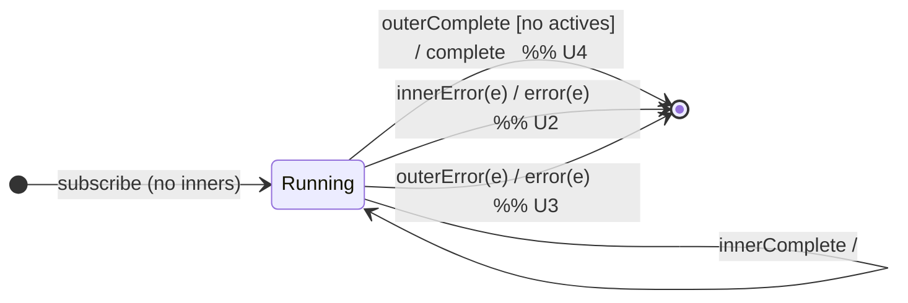

# Session 6 — Higher-Order Flattening as Mealy Machines

> 12 operators that take a source of values, turn each into an **inner
> Observable**, subscribe to those inners, and flatten their emissions into one
> output stream. The headline insight: **they are one machine skeleton with
> four different δ (transition) policies** for managing inner subscriptions.

Operators covered:

| Strategy  | `project` form | `identity`/`*All` form | `*To` alias (deprecated) |
|-----------|----------------|------------------------|--------------------------|
| **merge** | `mergeMap`     | `mergeAll`             | `mergeMapTo`             |
| **concat**| `concatMap`    | `concatAll`            | `concatMapTo`            |
| **switch**| `switchMap`    | `switchAll`            | `switchMapTo`            |
| **exhaust**| `exhaustMap`  | `exhaustAll` / `exhaust`| (none)                  |

RxJS actually *implements* most of these in terms of one base:

```text
mergeMap(project, concurrent = Infinity)      -- the base (mergeInternals)
concatMap(project)   = mergeMap(project, 1)    -- concurrency 1 ⇒ a queue
mergeAll()           = mergeMap(identity)
concatAll()          = mergeAll(1) = mergeMap(identity, 1)
switchAll()          = switchMap(identity)
exhaustAll()         = exhaustMap(identity)
exhaust()            = exhaustAll()            -- deprecated alias
mergeMapTo(inner)    = mergeMap(() => inner)   -- deprecated
```

So `*All` = `*Map(identity)` (the source already emits observables), and `*To`
= `*Map(() => fixedInner)`. **We only need to model the four `*Map` machines;
everything else is a specialisation of one of them.**

---

## 1. The shared skeleton

### Two input alphabets (outer + inner)

Like `withLatestFrom`/`sequenceEqual`, these subscribe to more than one stream —
but here the *inner* streams are **created dynamically**, one per outer value.
Tag notifications by origin:

- Outer (source): `outerNext(v)`, `outerComplete`, `outerError(e)`.
- Inner `i`: `innerNext_i(x)`, `innerComplete_i`, `innerError_i(e)`.

### Σ, Λ, Q (skeleton)

- **Σ** = outer notifications ∪ inner notifications.
- **Λ** = `{ emit(x), complete, error(e), noop }` — every inner `next` is
  forwarded as output `emit`.
- **Q** = a state carrying the **active inner subscriptions** plus flags:
  `Running(actives, buffer, outerDone)` and `Done`. `actives` and `buffer` are
  used differently by each policy (below). `q₀ = Running(∅, ∅, false)`.

### The universal edges (identical across all four)

| # | Input            | Output                                              |
|---|------------------|-----------------------------------------------------|
| U1| `innerNext_i(x)` | `emit(x)` — forward every inner value               |
| U2| `innerError_i(e)`| `error(e)`, tear down everything → `Done`           |
| U3| `outerError(e)`  | `error(e)`, tear down everything → `Done`           |
| U4| completion       | `complete` **only when** outer is done **and** no actives remain |

All the operators forward inner values the same way (U1) and fail fast on any
error (U2/U3). **The only thing that differs is what happens on `outerNext(v)`**
— i.e. the δ policy for starting/queuing/replacing inners, and the exact
completion bookkeeping (U4).

---

## 2. The four δ policies (`outerNext(v)` edge)

### merge — subscribe immediately, up to `concurrent`

State: `actives` (set), `buffer` (FIFO of outer values waiting for a slot).

| # | State (merge)          | `outerNext(v)`       | Guard                     | Next / Output                     |
|---|------------------------|----------------------|---------------------------|-----------------------------------|
| M1| `Running(A, B, _)`     | `outerNext(v)`       | `|A| < concurrent`        | subscribe `project(v)`; `A∪{i}`; `noop` |
| M2| `Running(A, B, _)`     | `outerNext(v)`       | `|A| = concurrent`        | enqueue `v` into `B`; `noop`      |
| M3| `Running(A, B, d)`     | `innerComplete_i`    | `B` non-empty             | `A\{i}`; dequeue & subscribe next; `noop` |
| M4| `Running(A, B, d)`     | `innerComplete_i`    | `B` empty                 | `A\{i}`; `noop`                   |

> With the default `concurrent = Infinity`, M2/M3's buffer logic never triggers
> — every inner runs at once and output **interleaves**. `mergeMap` preserves no
> ordering between inners.

### concat — merge with `concurrent = 1` (a strict queue)

Same table as merge with `concurrent = 1`: at most one inner active; later outer
values wait in `B` and run **in order, one after another**. Output is the inners
concatenated — **ordered, non-overlapping**.

### switch — keep only the latest inner

State: `cur` (the single current inner, or ∅).

| # | State (switch)      | `outerNext(v)`  | Next / Output                                     |
|---|---------------------|-----------------|---------------------------------------------------|
| S1| `Running(cur, d)`   | `outerNext(v)`  | **unsubscribe `cur`**; subscribe `project(v)` as new `cur`; `noop` |
| S2| `Running(cur, d)`   | `innerComplete` | `cur := ∅`; `noop`                                |

> A new outer value **cancels** the in-flight inner (its pending/future values
> are dropped). Only the most recent inner's values reach the output. This is
> the "latest wins" policy — ideal for type-ahead search.

### exhaust — ignore new outers while an inner is busy

State: `busy` flag (+ the current inner).

| # | State (exhaust)      | `outerNext(v)`  | Guard        | Next / Output                        |
|---|----------------------|-----------------|--------------|--------------------------------------|
| E1| `Running(busy, d)`   | `outerNext(v)`  | `busy=false` | subscribe `project(v)`; `busy=true`; `noop` |
| E2| `Running(busy, d)`   | `outerNext(v)`  | `busy=true`  | **drop `v`**; `noop`                 |
| E3| `Running(busy, d)`   | `innerComplete` | —            | `busy=false`; `noop`                 |

> The dual of switch: switch drops the **old** inner for the **new** value;
> exhaust drops the **new** value to protect the **old** inner. "First wins
> until it finishes" — ideal for debouncing repeated submit clicks.

---

## 3. A single STD, four edge-label sets



The node/edge *shape* is identical for all four; only the `outerNext` and
`innerComplete` edge labels change. That is the whole point of this session:
**flattening = one Mealy skeleton parameterised by an inner-subscription
policy.**

---

## 4. Completion bookkeeping (U4) — the subtle part

Output completes only when **both**:

1. the outer source has completed, **and**
2. there are no active inners (and, for merge/concat, the buffer is empty).

Consequences the tests pin down:

- **merge/concat**: if the outer completes but inners are still running, the
  output stays open until the last inner finishes.
- **switch**: if the outer completes while the current inner is still running,
  the output waits for that inner; but if a *new* outer value had switched, only
  the latest inner matters.
- **exhaust**: if the outer completes while an inner is running, output waits
  for that inner (any outer values dropped during that time are gone).

---

## 5. From STT rows to test cases

Each `*Map` operator has its own test file (`tests/49-*` … `tests/52-*`), plus
`*All`/`*To` alias tests (`tests/53-*`, `tests/54-*`). We use `cold` inner
observables with explicit durations so the four policies produce **visibly
different** marble outputs from the *same* source + inner shapes. Every `it(...)`
is annotated with the skeleton row (U*/M*/S*/E*) it exercises.

### The four policies on identical inputs (oracle-confirmed)

With outer `ab|` (a@0, b@1) and inner `x-y|` (emits `v0@0`, `v1@2`), the four
`*Map` policies produce four distinct outputs — the single clearest artifact of
this session:

| Policy    | Output (frame:value)                       | What happened to b's arrival @1 |
|-----------|--------------------------------------------|---------------------------------|
| `mergeMap`  | `0:a0  1:b0  2:a1  3:b1  4:C`             | both inners run; outputs interleave by time |
| `concatMap` | `0:a0  2:a1  3:b0  5:b1  6:C`             | b **queued**; its inner starts only after a's completes |
| `switchMap` | `0:a0  1:b0  3:b1  4:C`                   | b **cancels** a's inner — `a1` never emits |
| `exhaustMap`| `0:a0  2:a1  3:C`                         | b **dropped** — a's inner was still busy |

Read the second column top-to-bottom: *run / queue / cancel / drop*. That is the
entire taxonomy of higher-order flattening in one table — four δ policies over
one Mealy skeleton.
