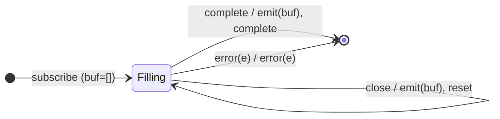

# Session 9 — Buffering & Windowing as Mealy Machines

> 9 operators that **group** source values — either into **arrays** (buffer\*)
> or into **nested Observables** (window\*) — driven by a **boundary signal**.
> Plus `groupBy` (partition into keyed sub-streams) and `expand` (recursive
> `mergeMap`). The buffer/window pair is a clean duality: *same boundary logic,
> different container*.

Operators covered:

| Boundary mechanism      | buffer\* (→ arrays) | window\* (→ Observables) |
|-------------------------|---------------------|--------------------------|
| external notifier       | `buffer`            | `window`                 |
| per-cycle closing selector | `bufferWhen`     | `windowWhen`             |
| openings + closings (overlapping) | `bufferToggle` | `windowToggle`      |
| count boundary          | (`bufferCount`, S2) | `windowCount`            |

Standalone: `groupBy` (keyed partition), `expand` (recursive flatten).

Common alphabet: `next(v)`, `complete`, `error(e)`, plus a **boundary** input
symbol (`close`/`open`) from a second stream. Λ emits either an **array** or an
**Observable**.

---

## 1. The buffer/window duality

Both accumulate values and release a group on a boundary. The *only* structural
difference is **what Λ emits**:

- **buffer\***: Q holds a plain array `buf`; the flush edge emits `buf` and
  resets to `[]`.
- **window\***: Q holds a live `Subject` `win`; each source `next` is forwarded
  *into* `win`; the boundary **completes** the current `win` and opens a new
  one. The flush edge emits the *Subject as an Observable* (usually at open
  time, so subscribers see values as they arrive).

So every buffer\* STT below has a window\* twin obtained by replacing
"append to array / emit array" with "next into Subject / emit new Subject".

---

## 2. External notifier — `buffer` / `window`

`buffer(closingNotifier)`: collect until `closingNotifier` emits, then flush and
start a new buffer. `window(boundaries)`: same, emitting Observables.

- **Q (buffer)** = `{ Filling(buf), Done }`.

| # | State          | Input            | Next / Output                         |
|---|----------------|------------------|---------------------------------------|
| 1 | `Filling(buf)` | `next(v)`        | `Filling(buf+[v])`; `noop`            |
| 2 | `Filling(buf)` | `close` (notifier)| `Filling([])`; `emit(buf)`           |
| 3 | `Filling(buf)` | `complete`       | `Done`; `emit(buf)` (final), `complete`|
| 4 | `Filling(buf)` | `error(e)`       | `Done`; `error(e)`                    |

> The boundary is a **second input alphabet** (like `takeUntil`'s notifier). A
> `close` with an empty buffer still emits `[]` (buffer) / an empty closed
> window (window).

---

## 3. Per-cycle closing selector — `bufferWhen` / `windowWhen`

Instead of one long-lived notifier, a **fresh** closing Observable is created
for each cycle via `closingSelector()`. When it emits/completes, flush and call
the selector again for the next cycle.

Same STT as `buffer`/`window`, but the `close` symbol now comes from a
*per-cycle* inner observable the operator subscribes to and re-creates on each
flush. State additionally tracks the current closing subscription.

---

## 4. Openings + closings (overlapping) — `bufferToggle` / `windowToggle`

`bufferToggle(openings, closingSelector)`: an **opening** signal starts a *new*
buffer; each open buffer is closed by its *own* `closingSelector(openValue)`
observable. Because a new opening can arrive before the previous buffer closes,
**multiple buffers can be open simultaneously** — a value may land in several.

- **Q** = `{ Active(buffers: set of open buffers), Done }`.

| # | State              | Input                 | Next / Output                                  |
|---|--------------------|-----------------------|------------------------------------------------|
| 1 | `Active(B)`        | `open(o)`             | `B ∪ {newBuffer}`; subscribe its closing; `noop`|
| 2 | `Active(B)`        | `next(v)`             | append `v` to **every** buffer in `B`; `noop`  |
| 3 | `Active(B)`        | `close_k` (buffer k's closing emits) | remove k; `emit(k.buf)`         |
| 4 | `Active(B)`        | `complete`            | `Done`; `complete` (open buffers are discarded, not flushed) |
| 5 | `Active(B)`        | `error(e)`            | `Done`; `error(e)`                             |

> This is the first operator where **multiple accumulators coexist** (a *set* of
> buffers), and a single `next` fans out into all of them (Row 2). That overlap
> is impossible with the single-notifier `buffer`. Row 4: on source complete,
> still-open buffers are **not** emitted.

---

## 5. Count boundary — `windowCount(size, startWindowEvery?)`

The window analogue of `bufferCount(size, startEvery)`: open a new window every
`startWindowEvery` values, each carrying at most `size` values. With
`startWindowEvery < size`, windows **overlap** (a value appears in several).

| # | State              | Input      | Guard                    | Next / Output                               |
|---|--------------------|------------|--------------------------|---------------------------------------------|
| 1 | `Windows(W, i)`    | `next(v)`  | —                        | push `v` into every open window; maybe open a new window at the `startEvery` boundary; close any window that reached `size`; `noop`/`emit(newWindow)` |
| 2 | `Windows(W, i)`    | `complete` | —                        | complete all open windows; `complete`       |
| 3 | `Windows(W, i)`    | `error(e)` | —                        | `error(e)`                                  |

> It is the counting cousin of `windowToggle`: the "openings" and "closings" are
> driven by the value **count** instead of external observables.

---

## 6. `groupBy(keySelector, options?)` — keyed partition

Partition the source into multiple sub-streams, one per distinct key. Each
distinct key spawns a `GroupedObservable` (a Subject tagged with its `key`);
subsequent values with that key are pushed into the matching group.

- **Q** = `{ Grouping(map: key → Subject), Done }`.

| # | State              | Input      | Guard            | Next / Output                                   |
|---|--------------------|------------|------------------|-------------------------------------------------|
| 1 | `Grouping(M)`      | `next(v)`  | `key(v) ∉ M`     | create Subject g; `M[key]:=g`; push v into g; `emit(g)` (the new group) |
| 2 | `Grouping(M)`      | `next(v)`  | `key(v) ∈ M`     | push v into `M[key]`; `noop` (no new group out) |
| 3 | `Grouping(M)`      | `complete` | —                | complete every group **and** the output; `complete` |
| 4 | `Grouping(M)`      | `error(e)` | —                | error every group and the output; `error(e)`    |

> Rows 1 vs 2 are the guarded fork on "have we seen this key before?" — a new
> key emits a *new group observable* downstream (Row 1); a known key silently
> routes the value into its existing group (Row 2). Structurally this is
> `distinct`'s seen-set (S5) crossed with `window`'s Subject-per-group.

---

## 7. `expand(project, concurrent?)` — recursive mergeMap

Like `mergeMap`, but the inner observable's outputs are **fed back as new
inputs** to `project`, recursively, breadth-first. Every emitted value is both
output **and** re-projected.

- **Q** = `{ Expanding(actives), Done }` (same inner-subscription bookkeeping as
  `mergeMap`, S6).

| # | State              | Input (outer or inner feedback) | Next / Output                               |
|---|--------------------|-------------------------------|---------------------------------------------|
| 1 | `Expanding(A)`     | `next(v)`                     | `emit(v)`; subscribe `project(v)`; `A∪{i}`  |
| 2 | `Expanding(A)`     | `innerNext(x)`                | treat `x` as a new input → **emit(x) AND re-project(x)** |
| 3 | `Expanding(A)`     | `innerComplete_i`             | `A\{i}`; `noop`                             |
| 4 | `Expanding(∅)`     | all done                      | `Done`; `complete`                          |
| 5 | any                | `error(e)`                    | `Done`; `error(e)`                          |

> The defining edge is Row 2: an inner emission is **both** forwarded and
> recursively re-fed. `expand` is `mergeMap` with the output wired back into the
> input — a fixed-point/BFS generator. It must be bounded (the project function
> must eventually produce `EMPTY`) or it never completes.

---

## From STT rows to test cases

Each operator (or buffer/window pair) has a test file (`tests/68-*` …
`tests/74-*`). The buffer tests show array-flush on each boundary; the window
tests flatten each nested Observable back to an array (via
`mergeMap(w => w.pipe(toArray()))`) to compare contents. `bufferToggle` shows
**overlapping** buffers; `groupBy` shows a new group observable per key with
values routed correctly; `expand` shows the breadth-first recursion bounded by
an `EMPTY` base case. Every `it(...)` is annotated with its STT row.
