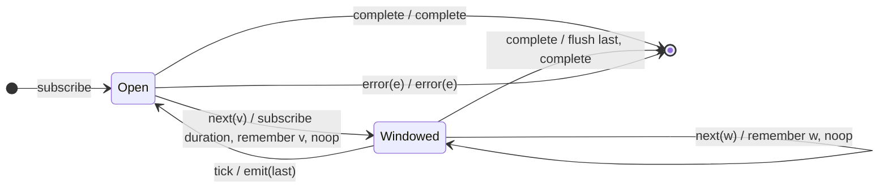

# `audit` as a Mealy Machine

> `audit(durationSelector)` opens a silence window driven by a per-value
> **duration observable** and, when it closes, emits the **last** value seen
> during the window (trailing). It is the duration-selector generalization of
> [`auditTime`](auditTime.md).

Signature:

```ts
audit<T>(durationSelector: (value: T) => ObservableInput<any>)
```

---

## 1. The 6-Tuple  M = (Q, Σ, Λ, δ, λ, q₀)

### Q — States

- `Open` — no window active.
- `Windowed(last)` — window open, holding the newest value.
- `Done` — terminal.

### Σ — Input alphabet

- `next(v)`, `complete`, `error(e)`, plus `tick` (the duration observable fires).

### Λ — Output alphabet

- `emit(x)`, `complete`, `error(e)`, `noop`.

### δ, λ

The first value opens a window via `durationSelector(v)` and is remembered;
later values overwrite the remembered value; the window closing emits the
trailing value.

### q₀ — Initial state

`q₀ = Open`.

---

## 2. State Transition Table (STT)

| # | State            | Input      | Next / Output                                |
|---|------------------|------------|----------------------------------------------|
| 1 | `Open`           | `next(v)`  | `Windowed(v)`; subscribe duration; `noop`    |
| 2 | `Windowed(last)` | `next(w)`  | `Windowed(w)`; `noop` (remember newest)      |
| 3 | `Windowed(last)` | `tick`     | `Open`; `emit(last)` (trailing emit)         |
| 4 | any              | `complete` | flush pending `last` if any; `complete`      |
| 5 | any              | `error(e)` | `Done`; `error(e)`                           |

---

## 3. State Transition Diagram (STD)



---

## 4. From STT rows to test cases

- **Rows 1-3** — emits the trailing value when the duration selector fires.

See [`tests/62b-audit.test.ts`](../../tests/62b-audit.test.ts).

---

## Relationship to the family

`audit` is the duration-selector form of [`auditTime`](auditTime.md); the
trailing dual of [`throttle`](throttle.md). See
[`14-time-family.md`](../14-time-family.md).
