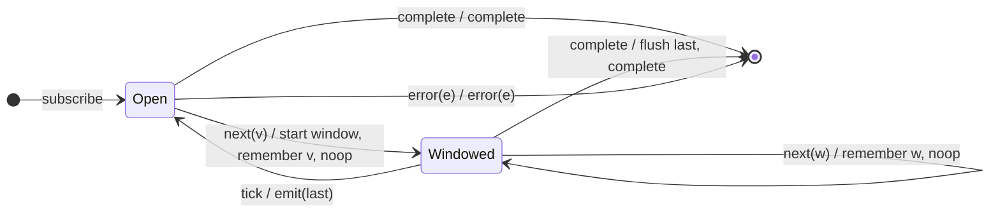

# `auditTime` as a Mealy Machine

> `auditTime(d)` opens a silence window of `d` ms on a value and, when the window
> closes, emits the **last** value seen during it (trailing). It is the trailing
> dual of `throttleTime` and equals `audit(() => timer(d))`.

Signature:

```ts
auditTime<T>(duration: number, scheduler?: SchedulerLike)
```

---

## 1. The 6-Tuple  M = (Q, Σ, Λ, δ, λ, q₀)

### Q — States

- `Open` — no window active.
- `Windowed(last)` — window open, holding the newest value seen so far.
- `Done` — terminal.

### Σ — Input alphabet

- `next(v)`, `complete`, `error(e)`, plus `tick` (the `timer(d)` fires).

### Λ — Output alphabet

- `emit(x)`, `complete`, `error(e)`, `noop`.

### δ, λ

The first value opens a `d`-ms window and is remembered (no leading emit); later
values during the window overwrite the remembered value. When the window closes
(`tick`), the remembered (trailing) value is emitted.

### q₀ — Initial state

`q₀ = Open`.

---

## 2. State Transition Table (STT)

| # | State            | Input      | Next / Output                           |
|---|------------------|------------|-----------------------------------------|
| 1 | `Open`           | `next(v)`  | `Windowed(v)`; start duration; `noop`   |
| 2 | `Windowed(last)` | `next(w)`  | `Windowed(w)`; `noop` (remember newest) |
| 3 | `Windowed(last)` | `tick`     | `Open`; `emit(last)` (trailing emit)    |
| 4 | any              | `complete` | flush pending `last` if any; `complete` |
| 5 | any              | `error(e)` | `Done`; `error(e)`                      |

Contrast with `throttle*`: there Row 1 emits immediately (leading) and `tick` is
silent; here Row 1 is silent and `tick` emits the trailing value.

---

## 3. State Transition Diagram (STD)



---

## 4. From STT rows to test cases

- **Rows 1-3** — emits the trailing (last) value of each silence window.

See [`tests/62a-auditTime.test.ts`](../../tests/62a-auditTime.test.ts).

---

## Relationship to the family

`auditTime(d)` = [`audit`](audit.md)`(() => timer(d))`; the trailing dual of
[`throttle`](throttle.md). See [`14-time-family.md`](../14-time-family.md).
