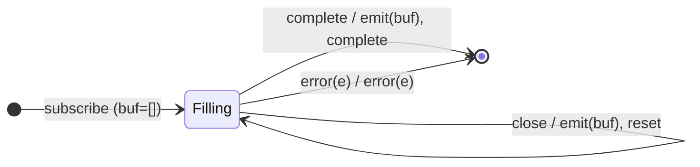

# `buffer` as a Mealy Machine

> `buffer(closingNotifier)` collects source values into an array and **flushes**
> the array each time `closingNotifier` emits, then starts a fresh buffer. The
> boundary is a **second input alphabet** (like `takeUntil`'s notifier).

Signature:

```ts
buffer<T>(closingNotifier: Observable<any>)
```

---

## 1. The 6-Tuple  M = (Q, Σ, Λ, δ, λ, q₀)

### Q — States

- `Filling(buf)` — the current buffer array.
- `Done` — terminal.

### Σ — Input alphabet (source + notifier)

- `next(v)`, `complete`, `error(e)`, plus `close` (the notifier emits).

### Λ — Output alphabet

- `emit(array)`, `complete`, `error(e)`, `noop`.

### δ, λ

Each `next(v)` appends silently. A `close` emits the current buffer (even if
empty → `[]`) and resets it. On `complete` the final partial buffer is emitted.

### q₀ — Initial state

`q₀ = Filling([])`.

---

## 2. State Transition Table (STT)

| # | State          | Input              | Next / Output                            |
|---|----------------|--------------------|------------------------------------------|
| 1 | `Filling(buf)` | `next(v)`          | `Filling(buf ++ [v])`; `noop`            |
| 2 | `Filling(buf)` | `close` (notifier) | `Filling([])`; `emit(buf)`               |
| 3 | `Filling(buf)` | `complete`         | `Done`; `emit(buf)` (final), `complete`  |
| 4 | `Filling(buf)` | `error(e)`         | `Done`; `error(e)` (pending buffer dropped)|

---

## 3. State Transition Diagram (STD)



---

## 4. From STT rows to test cases

- **Rows 1-3** — flushes a buffer array each time the notifier emits, plus the
  final partial on completion.
- **Row 4** — error drops the pending buffer.

See [`tests/68a-buffer.test.ts`](../../tests/68a-buffer.test.ts).

---

## Relationship to the family

`buffer` is the array-valued, external-notifier case; [`window`](window.md) is
its Observable-valued twin, and [`bufferWhen`](bufferWhen.md) replaces the single
notifier with a per-cycle closing selector. See
[`15-buffering-windowing-family.md`](../15-buffering-windowing-family.md).
