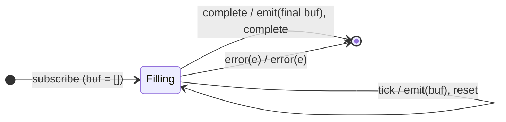

# `bufferTime` as a Mealy Machine

> `bufferTime(span)` collects values into an array and emits the array on each
> timer tick every `span` ms, then resets. Unlike `bufferCount` (flush on
> count), the boundary is **time** — so a window with no values still emits an
> empty array `[]`.

Signature:

```ts
bufferTime<T>(bufferTimeSpan: number, ...rest)
```

---

## 1. The 6-Tuple  M = (Q, Σ, Λ, δ, λ, q₀)

### Q — States

- `Filling(buf)` — the current buffer array.
- `Done` — terminal.

### Σ — Input alphabet

- `next(v)`, `complete`, `error(e)`, plus `tick` (the `span` timer fires).

### Λ — Output alphabet

- `emit(array)`, `complete`, `error(e)`, `noop`.

### δ, λ

Each `next(v)` appends to the buffer silently. A `tick` emits the buffer (even if
empty) and resets it. On `complete` the final partial buffer is emitted.

### q₀ — Initial state

`q₀ = Filling([])`.

---

## 2. State Transition Table (STT)

| # | State          | Input      | Next / Output                                       |
|---|----------------|------------|-----------------------------------------------------|
| 1 | `Filling(buf)` | `next(v)`  | `Filling(buf ++ [v])`; `noop`                       |
| 2 | `Filling(buf)` | `tick`     | `Filling([])`; `emit(buf)` (even if empty → `[]`)   |
| 3 | `Filling(buf)` | `complete` | `Done`; `emit(buf)` (final partial), `complete`     |
| 4 | `Filling(buf)` | `error(e)` | `Done`; `error(e)`                                  |

Row 2 can emit `[]` — the key contrast with `bufferCount`.

---

## 3. State Transition Diagram (STD)



---

## 4. From STT rows to test cases

- **Rows 1-3** — emits a buffer every `span` ms, plus the final partial on
  completion.
- **Empty window** — emits `[]` when a window had no values.

See [`tests/64a-bufferTime.test.ts`](../../tests/64a-bufferTime.test.ts).

---

## Relationship to the family

`bufferTime` is the time-boundary cousin of `bufferCount` (Session 2);
[`windowTime`](windowTime.md) emits nested Observables instead of arrays. See
[`14-time-family.md`](../14-time-family.md).
