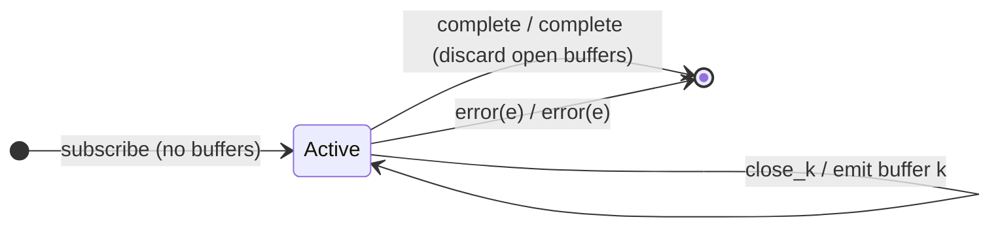

# `bufferToggle` as a Mealy Machine

> `bufferToggle(openings, closingSelector)` starts a **new buffer** on each
> `openings` signal; each open buffer is closed by its **own**
> `closingSelector(openValue)` observable. Because a new opening can arrive
> before a previous buffer closes, **multiple buffers can be open at once** — a
> single value fans out into all of them. This is the first operator with
> **coexisting accumulators**.

Signature:

```ts
bufferToggle<T, O>(openings: ObservableInput<O>, closingSelector: (value: O) => ObservableInput<any>)
```

---

## 1. The 6-Tuple  M = (Q, Σ, Λ, δ, λ, q₀)

### Q — States

- `Active(buffers)` — a **set** of currently-open buffers, each with its own
  closing subscription.
- `Done` — terminal.

### Σ — Input alphabet

- `next(v)`, `complete`, `error(e)`, plus `open(o)` (an opening) and `close_k`
  (buffer k's closing emits).

### Λ — Output alphabet

- `emit(array)`, `complete`, `error(e)`, `noop`.

### δ, λ

An `open(o)` adds a new buffer and subscribes its closing. A `next(v)` appends to
**every** open buffer. A `close_k` removes buffer k and emits its array. On
source `complete`, still-open buffers are **discarded**, not flushed.

### q₀ — Initial state

`q₀ = Active(∅)`.

---

## 2. State Transition Table (STT)

| # | State       | Input       | Next / Output                                        |
|---|-------------|-------------|------------------------------------------------------|
| 1 | `Active(B)` | `open(o)`   | `B ∪ {newBuffer}`; subscribe its closing; `noop`     |
| 2 | `Active(B)` | `next(v)`   | append `v` to **every** buffer in `B`; `noop`        |
| 3 | `Active(B)` | `close_k`   | remove k; `emit(k.buf)`                              |
| 4 | `Active(B)` | `complete`  | `Done`; `complete` (open buffers discarded, not flushed)|
| 5 | `Active(B)` | `error(e)`  | `Done`; `error(e)`                                  |

Row 2 is the fan-out: a single value lands in every open buffer — the overlap
that the single-notifier [`buffer`](buffer.md) cannot produce.

---

## 3. State Transition Diagram (STD)



---

## 4. From STT rows to test cases

- **Rows 1-3** — one buffer per opening, closed by its closing selector;
  overlapping openings yield overlapping buffers.

See [`tests/70a-bufferToggle.test.ts`](../../tests/70a-bufferToggle.test.ts).

---

## Relationship to the family

`bufferToggle` is the overlapping, openings+closings case; its Observable-valued
twin is [`windowToggle`](windowToggle.md). See
[`15-buffering-windowing-family.md`](../15-buffering-windowing-family.md).
