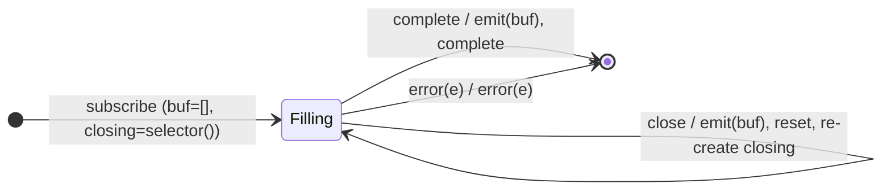

# `bufferWhen` as a Mealy Machine

> `bufferWhen(closingSelector)` collects values into an array and flushes it when
> a **fresh closing Observable** (created per cycle via `closingSelector()`)
> emits or completes; it then calls the selector again for the next cycle. It is
> [`buffer`](buffer.md) with a per-cycle boundary instead of one long-lived
> notifier.

Signature:

```ts
bufferWhen<T>(closingSelector: () => ObservableInput<any>)
```

---

## 1. The 6-Tuple  M = (Q, Σ, Λ, δ, λ, q₀)

### Q — States

- `Filling(buf, closing)` — current buffer plus the current closing
  subscription.
- `Done` — terminal.

### Σ — Input alphabet

- `next(v)`, `complete`, `error(e)`, plus `close` (the current closing inner
  fires).

### Λ — Output alphabet

- `emit(array)`, `complete`, `error(e)`, `noop`.

### δ, λ

Each `next(v)` appends silently. A `close` emits the buffer, resets it, and
**re-creates** the closing observable via `closingSelector()`.

### q₀ — Initial state

`q₀ = Filling([], closingSelector())`.

---

## 2. State Transition Table (STT)

| # | State              | Input      | Next / Output                                      |
|---|--------------------|------------|----------------------------------------------------|
| 1 | `Filling(buf, c)`  | `next(v)`  | `Filling(buf ++ [v], c)`; `noop`                   |
| 2 | `Filling(buf, c)`  | `close`    | `emit(buf)`; reset buffer; new `closingSelector()` |
| 3 | `Filling(buf, c)`  | `complete` | `Done`; `emit(buf)` (final), `complete`            |
| 4 | `Filling(buf, c)`  | `error(e)` | `Done`; `error(e)`                                 |

---

## 3. State Transition Diagram (STD)



---

## 4. From STT rows to test cases

- **Rows 1-3** — flushes per the closing selector's cycle (one buffer per
  closing).

See [`tests/68b-bufferWhen.test.ts`](../../tests/68b-bufferWhen.test.ts).

---

## Relationship to the family

`bufferWhen` is the per-cycle-selector form of [`buffer`](buffer.md); its
Observable-valued twin is [`windowWhen`](windowWhen.md). See
[`15-buffering-windowing-family.md`](../15-buffering-windowing-family.md).
