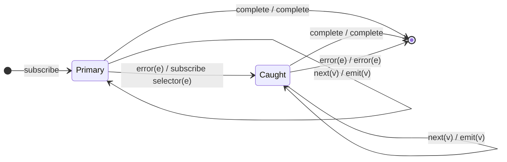

# `catchError` as a Mealy Machine

> `catchError(selector)` swaps to a **fallback observable** on error: the error
> notification is **consumed** and replaced by a subscription to
> `selector(err, caught)`. If the selector returns the source itself,
> `catchError` becomes an (uncounted) retry.

Signature:

```ts
catchError<T, O>(selector: (err: any, caught: Observable<T>) => ObservableInput<O>)
```

---

## 1. The 6-Tuple  M = (Q, Σ, Λ, δ, λ, q₀)

### Q — States

- `Primary` — mirroring the source.
- `Caught` — mirroring the fallback after an error was caught.
- `Done` — terminal.

### Σ — Input alphabet

- `next(v)`, `complete`, `error(e)` (from whichever observable is active).

### Λ — Output alphabet

- `emit(v)`, `complete`, `error(e)`, `noop`.

### δ, λ

In `Primary`, values/complete pass through. On `error`, the selector's
observable is subscribed and the machine moves to `Caught` (the error itself is
**not** forwarded). In `Caught` it mirrors the fallback, including a possible
error from the fallback.

### q₀ — Initial state

`q₀ = Primary`.

---

## 2. State Transition Table (STT)

| # | State     | Input      | Next / Output                                 |
|---|-----------|------------|-----------------------------------------------|
| 1 | `Primary` | `next(v)`  | `Primary`; `emit(v)`                          |
| 2 | `Primary` | `complete` | `Done`; `complete`                            |
| 3 | `Primary` | `error(e)` | subscribe `selector(e)`; `Caught`; `noop`     |
| 4 | `Caught`  | `next(v)`  | `Caught`; `emit(v)` (from the fallback)       |
| 5 | `Caught`  | `complete` | `Done`; `complete`                            |
| 6 | `Caught`  | `error(e)` | `Done`; `error(e)` (fallback itself failed)   |

Row 3 is the recovery edge: the error is consumed, not propagated.

---

## 3. State Transition Diagram (STD)



---

## 4. From STT rows to test cases

- **Rows 3-5** — on error, the output swaps to the fallback observable.
- **Row 2** — with no error, the fallback is never used.

See [`tests/74a-catchError.test.ts`](../../tests/74a-catchError.test.ts).

---

## Relationship to the family

`catchError` swaps to a fallback on error; [`onErrorResumeNextWith`](onErrorResumeNextWith.md)
swallows errors and advances through a list; [`retry`](retry.md) re-runs the
source on error. See
[`16-error-repeat-multicast-family.md`](../16-error-repeat-multicast-family.md).
