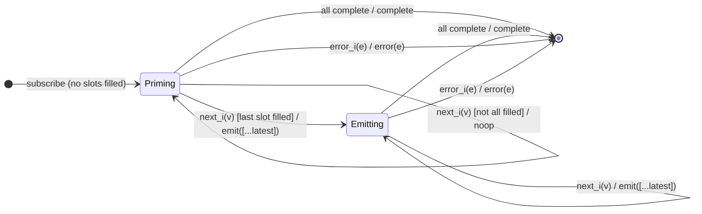

# `combineLatest` as a Mealy Machine

> `combineLatest([...sources])` keeps the **latest value of each source** and
> emits a combined array **every time any source emits** — but only once **all**
> sources have emitted at least one value. It is the latest-slots strategy of
> the combination family, generalising Session 2's `withLatestFrom` to N
> symmetric sources.

Signature:

```ts
combineLatest<T extends readonly ObservableInput<unknown>[]>(sources: [...T])
```

---

## 1. The 6-Tuple  M = (Q, Σ, Λ, δ, λ, q₀)

### Q — States

- `Priming(have, latest[])` — `have` is the set of sources that have emitted at
  least once; `latest` holds each source's most recent value.
- `Emitting(latest[])` — all sources have spoken; every new value re-emits.
- `Done` — terminal.

### Σ — Input alphabet (N sources, tagged `i`)

- `next_i(v)`, `complete_i`, `error_i(e)`.

### Λ — Output alphabet

- `emit(array)`, `complete`, `error(e)`, `noop`.

### δ, λ

Each `next_i(v)` updates slot `i`. Output is suppressed until every slot is
filled (the gate); thereafter any update emits a fresh combined array.

### q₀ — Initial state

`q₀ = Priming(∅, [empty…])`.

---

## 2. State Transition Table (STT)

| # | State            | Input        | Guard                      | Next / Output                        |
|---|------------------|--------------|----------------------------|--------------------------------------|
| 1 | `Priming(H,L)`   | `next_i(v)`  | `H ∪ {i} ≠ all`            | `Priming(H∪{i}, L[i:=v])`; `noop`    |
| 2 | `Priming(H,L)`   | `next_i(v)`  | `H ∪ {i} = all` (last one) | `Emitting(L[i:=v])`; `emit([...L])`  |
| 3 | `Emitting(L)`    | `next_i(v)`  | —                          | `Emitting(L[i:=v])`; `emit([...L])`  |
| 4 | any              | `complete_i` | other sources still live   | stay; `noop`                         |
| 5 | any              | all complete | —                          | `Done`; `complete`                   |
| 6 | any              | `error_i(e)` | —                          | `Done`; `error(e)`                   |

Row 2 is the gate: nothing emits until every source has spoken once. A source
completing without ever emitting makes the whole result complete empty (Rows
1→5).

---

## 3. State Transition Diagram (STD)



---

## 4. From STT rows to test cases

- **Rows 2+3** — emits once both sources have spoken, then re-emits on any
  change.
- **Row 1/5** — a source that never emits makes the result complete empty.
- **Row 6** — error from either source terminates.

See [`tests/55a-combineLatest.test.ts`](../../tests/55a-combineLatest.test.ts).

---

## Relationship to the family

`combineLatest` is the latest-slots strategy; [`combineLatestWith`](combineLatestWith.md)
is its pipeable form, [`combineLatestAll`](combineLatestAll.md) its higher-order
form, and [`withLatestFrom`](../08-withLatestFrom.md) the asymmetric cousin
(only the primary source triggers output). See
[`13-combination-family.md`](../13-combination-family.md).
