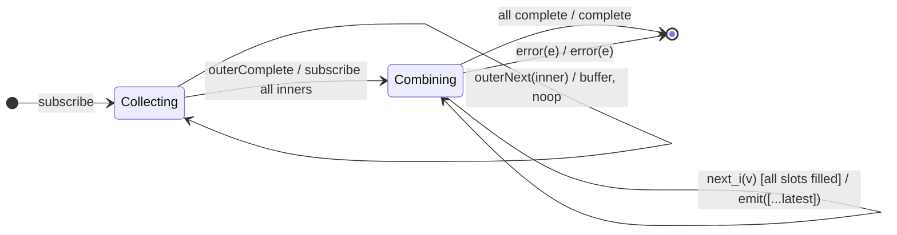

# `combineLatestAll` as a Mealy Machine

> `combineLatestAll()` flattens a **higher-order** source (a stream of
> Observables): it buffers all inner Observables until the outer completes, then
> applies [`combineLatest`](combineLatest.md) to the collected list. It is a
> **two-phase** machine. `combineAll()` is its deprecated alias.

Signature:

```ts
combineLatestAll<R>()
```

---

## 1. The 6-Tuple  M = (Q, Σ, Λ, δ, λ, q₀)

### Q — States

- `Collecting(inners[])` — Phase 1: buffering inner Observables from the outer.
- `Combining(…)` — Phase 2: the latest-slots machine of
  [`combineLatest`](combineLatest.md) over the collected inners.
- `Done` — terminal.

### Σ — Input alphabet

- Outer: `outerNext(inner)`, `outerComplete`, `outerError(e)`.
- Inner (after Phase 2 begins): `next_i(v)`, `complete_i`, `error_i(e)`.

### Λ — Output alphabet

- `emit(array)`, `complete`, `error(e)`, `noop`.

### δ, λ

Phase 1: every `outerNext(inner)` is buffered (`noop`). On `outerComplete`, move
to Phase 2 and subscribe all collected inners, then behave exactly like
`combineLatest`.

### q₀ — Initial state

`q₀ = Collecting([])`.

---

## 2. State Transition Table (STT)

| # | State               | Input              | Next / Output                              |
|---|---------------------|--------------------|--------------------------------------------|
| 1 | `Collecting(I)`     | `outerNext(inner)` | `Collecting(I ++ [inner])`; `noop`         |
| 2 | `Collecting(I)`     | `outerComplete`    | `Combining(combineLatest(I))`; `noop`      |
| 3 | `Combining(…)`      | inner notifications| as per [`combineLatest`](combineLatest.md) |
| 4 | any                 | `error(e)`         | `Done`; `error(e)`                         |

---

## 3. State Transition Diagram (STD)



---

## 4. From STT rows to test cases

- **Rows 1-3** — inner observables are combined with latest-slots semantics only
  after the outer completes.

See [`tests/59a-combineLatestAll.test.ts`](../../tests/59a-combineLatestAll.test.ts).

---

## Relationship to the family

`combineLatestAll` is the higher-order form of
[`combineLatest`](combineLatest.md); [`combineAll`](combineAll.md) is its
deprecated alias, and [`zipAll`](zipAll.md) is the per-queue analogue. See
[`13-combination-family.md`](../13-combination-family.md).
