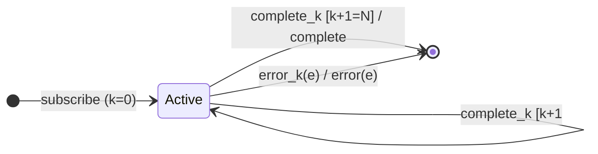

# `concat` as a Mealy Machine

> `concat(...sources)` subscribes to the sources **one at a time, in order**:
> source `k+1` starts only after source `k` completes. It forwards values as-is
> (no combination). It is `merge` with concurrency 1 and preserved order — the
> same relationship as `concatMap`/`mergeMap` in Session 6, over a *fixed* list.

Signature:

```ts
concat<T extends readonly ObservableInput<unknown>[]>(...sources: [...T])
```

---

## 1. The 6-Tuple  M = (Q, Σ, Λ, δ, λ, q₀)

### Q — States

- `Active(k)` — source `k` is the only one subscribed.
- `Done` — terminal.

### Σ — Input alphabet

- `next_k(v)`, `complete_k`, `error_k(e)` (only the active source `k`).

### Λ — Output alphabet

- `emit(v)`, `complete`, `error(e)`, `noop`.

### δ, λ

Values from the active source forward unchanged. On its completion, subscribe
the next source; after the last source completes, complete.

### q₀ — Initial state

`q₀ = Active(0)`.

---

## 2. State Transition Table (STT)

| # | State       | Input         | Next / Output                                                      |
|---|-------------|---------------|--------------------------------------------------------------------|
| 1 | `Active(k)` | `next_k(v)`   | `emit(v)`                                                          |
| 2 | `Active(k)` | `complete_k`  | if `k+1 < N`: `Active(k+1)` (subscribe next); else `Done`, `complete` |
| 3 | `Active(k)` | `error_k(e)`  | `Done`; `error(e)`                                                 |

Only source `k` is subscribed at a time; if an early source never completes,
later sources never run.

---

## 3. State Transition Diagram (STD)



---

## 4. From STT rows to test cases

- **Row 2** — a non-completing first source blocks the second from ever running.

See [`tests/57a-concat.test.ts`](../../tests/57a-concat.test.ts).

---

## Relationship to the family

`concat` is the sequential strategy; [`concatWith`](concatWith.md) is its
pipeable form, and [`merge`](merge.md) is the interleaving (concurrent)
counterpart. See [`13-combination-family.md`](../13-combination-family.md).
