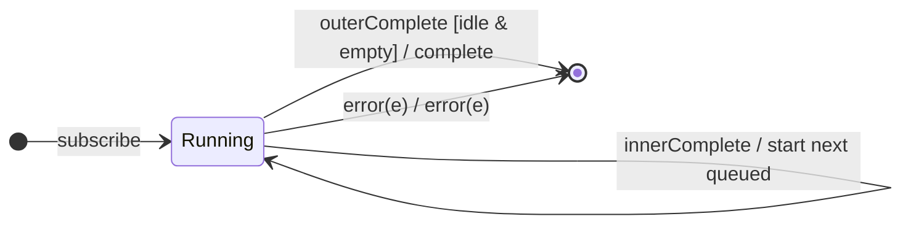

# `concatAll` as a Mealy Machine

> `concatAll()` flattens a higher-order Observable by subscribing to its inner
> Observables **one at a time, in order**. It is `mergeAll(1)` =
> `concatMap(identity)` — the **concat policy** (queue) with identity
> projection.

Signature:

```ts
concatAll<T>()
```

---

## 1. The 6-Tuple  M = (Q, Σ, Λ, δ, λ, q₀)

Identical skeleton to [`concatMap`](concatMap.md) with `project = identity`.

### Q — States

- `Running(cur?, buffer, outerDone)`, `Done`.

### δ, λ

Each `outerNext(inner)` starts `inner` if idle, else queues it; on inner
completion the next queued inner starts. Inner values forward. `q₀ = Running(∅,
∅, false)`.

---

## 2. State Transition Table (STT)

| # | State                | Input               | Guard          | Next / Output                          |
|---|----------------------|---------------------|----------------|----------------------------------------|
| U1| `Running(c,B,_)`     | `innerNext(x)`      | —              | `emit(x)`                              |
| M1| `Running(∅,B,_)`     | `outerNext(inner)`  | idle           | subscribe `inner` as `cur`; `noop`     |
| M2| `Running(c,B,_)`     | `outerNext(inner)`  | busy           | enqueue; `noop`                        |
| M3| `Running(c,B,_)`     | `innerComplete`     | queue non-empty| start next queued; `noop`              |
| M4| `Running(c,B,_)`     | `innerComplete`     | queue empty    | `cur := ∅`; `noop`                     |
| U4| `Running(∅,∅,true)`  | (inner done)        | outer done     | `complete`                             |
| U2/U3| `Running(…)`      | inner/outer error   | —              | `error(e)` → `Done`                    |

---

## 3. State Transition Diagram (STD)



---

## 4. From STT rows to test cases

- **M1-M3** — inners run strictly in order; the second starts only after the
  first completes.

See [`tests/53b-concatAll.test.ts`](../../tests/53b-concatAll.test.ts).

---

## Relationship to the family

`concatAll()` = `mergeAll(1)` = [`concatMap`](concatMap.md)`(identity)`. See
[`12-flattening-family.md`](../12-flattening-family.md).
