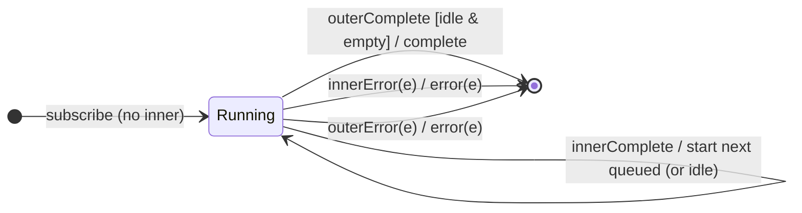

# `concatMap` as a Mealy Machine

> `concatMap(project)` maps each source value to an inner Observable and
> subscribes to them **one at a time, in order** — the next inner starts only
> after the current one completes. It is `mergeMap(project, 1)`: the **concat
> policy** = *queue*. Output is ordered and non-overlapping.

Signature:

```ts
concatMap<T, R>(project: (value: T, index: number) => ObservableInput<R>)
```

---

## 1. The 6-Tuple  M = (Q, Σ, Λ, δ, λ, q₀)

### Q — States

- `Running(cur?, buffer, outerDone)` — at most one active inner `cur`, a FIFO of
  outer values waiting their turn, and whether the outer completed.
- `Done` — terminal.

### Σ — Input alphabet

- Outer: `outerNext(v)`, `outerComplete`, `outerError(e)`.
- Inner: `innerNext(x)`, `innerComplete`, `innerError(e)`.

### Λ — Output alphabet

- `emit(x)`, `complete`, `error(e)`, `noop`.

### δ, λ

Inner values forward. A source value starts its inner immediately if none is
active, else it is queued. On inner completion the next queued value's inner
starts.

### q₀ — Initial state

`q₀ = Running(∅, ∅, false)`.

---

## 2. State Transition Table (STT)

| # | State                   | Input           | Guard             | Next state / Output                     |
|---|-------------------------|-----------------|-------------------|-----------------------------------------|
| U1| `Running(c,B,_)`        | `innerNext(x)`  | —                 | `emit(x)`                               |
| M1| `Running(∅,B,_)`        | `outerNext(v)`  | no active inner   | subscribe `project(v)` as `cur`; `noop` |
| M2| `Running(c,B,_)`        | `outerNext(v)`  | inner active      | enqueue `v` in `B`; `noop`              |
| M3| `Running(c,B,_)`        | `innerComplete` | `B` non-empty     | dequeue & subscribe next as `cur`; `noop`|
| M4| `Running(c,B,_)`        | `innerComplete` | `B` empty         | `cur := ∅`; `noop`                      |
| U4| `Running(∅,∅,true)`     | (inner done)    | outer done, empty | `complete`                              |
| U2| `Running(c,B,_)`        | `innerError(e)` | —                 | `error(e)` → `Done`                     |
| U3| `Running(c,B,_)`        | `outerError(e)` | —                 | `error(e)` → `Done`                     |

M2 (queue) is the defining edge: a value arriving while an inner is active waits
rather than running concurrently.

---

## 3. State Transition Diagram (STD)



---

## 4. From STT rows to test cases

- **M1-M3** — a second source value's inner starts only after the first
  completes; output is strictly ordered.

See [`tests/50-concatMap.test.ts`](../../tests/50-concatMap.test.ts).

---

## Relationship to the family

`concatMap` = [`mergeMap`](mergeMap.md)`(·, 1)`; [`concatAll`](concatAll.md) is
`concatMap(identity)` and [`concatMapTo`](concatMapTo.md) is
`concatMap(() => inner)`. The concat policy is *queue*. See
[`12-flattening-family.md`](../12-flattening-family.md).
