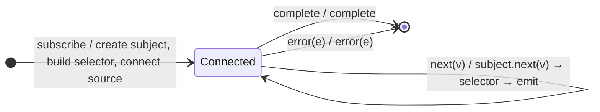

# `connect` as a Mealy Machine

> `connect(selector, config?)` is the **modern multicast primitive**: it shares
> the source through a multicast subject for the duration of a `selector` you
> provide, letting you reference the shared stream multiple times within the
> selector's observable graph. The source is subscribed once; the selector's
> result is the output.

Signature:

```ts
connect<T, O>(selector: (shared: Observable<T>) => ObservableInput<O>, config?: ConnectConfig<T>)
```

---

## 1. The 6-Tuple  M = (Q, Σ, Λ, δ, λ, q₀)

### Q — States

- `Connected(subject)` — the source is subscribed through the multicast
  subject; the selector's graph is live.
- `Done` — terminal.

### Σ — Input alphabet

- `next(v)`, `complete`, `error(e)` (from the source, via the subject).

### Λ — Output alphabet

- `emit(x)` (from the selector's result), `complete`, `error(e)`, `noop`.

### δ, λ

On subscription, a multicast subject is created, the `selector(shared)` graph is
built, and the source is connected. Every source value fans into the subject and
flows through the selector's graph to the output.

### q₀ — Initial state

`q₀ = Connected(subject)`.

---

## 2. State Transition Table (STT)

| # | State               | Input      | Next / Output                               |
|---|---------------------|------------|---------------------------------------------|
| 1 | `Connected(S)`      | `next(v)`  | `S.next(v)` → selector graph; `emit(f(v))`  |
| 2 | `Connected(S)`      | `complete` | `Done`; `complete`                          |
| 3 | `Connected(S)`      | `error(e)` | `Done`; `error(e)`                          |

The output shape is whatever the selector builds from the shared source.

---

## 3. State Transition Diagram (STD)



---

## 4. From STT rows to test cases

- **Row 1** — the source is shared inside the selector (e.g. mapped), and the
  selector's result is emitted.

See [`tests/78a-connect.test.ts`](../../tests/78a-connect.test.ts).

---

## Relationship to the family

`connect` is the modern connect-policy face of the multicast skeleton;
[`multicast`](multicast.md) is the classic `ConnectableObservable` primitive, and
[`share`](share.md) is the ref-counted all-in-one. See
[`16-error-repeat-multicast-family.md`](../16-error-repeat-multicast-family.md).
