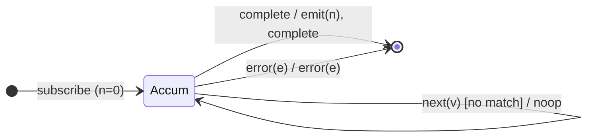

# `count` as a Mealy Machine

> `count(predicate?)` folds the stream into a single number — how many values
> (optionally matching a predicate) arrived — emitted **on completion**. It is
> `reduce` with a counting accumulator: accumulate silently, emit once on the
> completion edge.

Signature:

```ts
count<T>(predicate?: (value: T, index: number) => boolean)
```

---

## 1. The 6-Tuple  M = (Q, Σ, Λ, δ, λ, q₀)

### Q — States

- `Accum(n)` — running count `n`.
- `Done` — terminal.

### Σ — Input alphabet

- `next(v)`, `complete`, `error(e)`.

### Λ — Output alphabet

- `emit(number)`, `complete`, `error(e)`, `noop`.

### δ, λ

Each value increments the count when it matches (or unconditionally if no
predicate), always `noop`. On `complete` the count is emitted (even `0` for an
empty source).

### q₀ — Initial state

`q₀ = Accum(0)`.

---

## 2. State Transition Table (STT)

| # | State      | Input (Σ)  | Guard                       | Next state   | Output (λ)             |
|---|------------|------------|-----------------------------|--------------|------------------------|
| 1 | `Accum(n)` | `next(v)`  | matches (or no predicate)   | `Accum(n+1)` | `noop`                 |
| 2 | `Accum(n)` | `next(v)`  | predicate present, no match | `Accum(n)`   | `noop`                 |
| 3 | `Accum(n)` | `complete` | —                           | `Done`       | `emit(n)`, `complete`  |
| 4 | `Accum(n)` | `error(e)` | —                           | `Done`       | `error(e)`             |

Like `toArray`, `count` always emits on completion (even `0`), because it has a
numeric seed.

---

## 3. State Transition Diagram (STD)



---

## 4. From STT rows to test cases

- **Rows 1+3** — counts all values, emits the total on completion.
- **With predicate** — counts only matching values.
- **Empty source** — emits `0`.

See [`tests/41-count.test.ts`](../../tests/41-count.test.ts).

---

## Relationship to the family

`count` is a `reduce` with a counting accumulator — an emit-on-complete fold like
[`toArray`](toArray.md), [`max`](max.md), and [`min`](min.md). See
[`11-aggregation-family.md`](../11-aggregation-family.md).
