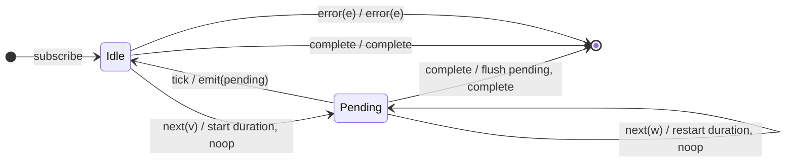

# `debounce` as a Mealy Machine

> `debounce(durationSelector)` emits the latest value only after its per-value
> **duration observable** fires with **no intervening source value** — a new
> value restarts the duration. It is the duration-selector generalization of
> `debounceTime` (Session 1): emit on the quiet period.

Signature:

```ts
debounce<T>(durationSelector: (value: T) => ObservableInput<any>)
```

---

## 1. The 6-Tuple  M = (Q, Σ, Λ, δ, λ, q₀)

### Q — States

- `Idle` — nothing pending.
- `Pending(v)` — holding value `v`, waiting for its duration to fire quietly.
- `Done` — terminal.

### Σ — Input alphabet

- `next(v)`, `complete`, `error(e)`, plus `tick` (the duration observable fires).

### Λ — Output alphabet

- `emit(x)`, `complete`, `error(e)`, `noop`.

### δ, λ

Each `next(v)` stores `v` and **restarts** its duration (cancelling any prior).
If the duration fires before another value arrives, `v` is emitted. A pending
value is flushed on completion.

### q₀ — Initial state

`q₀ = Idle`.

---

## 2. State Transition Table (STT)

| # | State        | Input      | Next / Output                                   |
|---|--------------|------------|-------------------------------------------------|
| 1 | `Idle`       | `next(v)`  | `Pending(v)`; start duration; `noop`            |
| 2 | `Pending(v)` | `next(w)`  | `Pending(w)`; restart duration; `noop`          |
| 3 | `Pending(v)` | `tick`     | `Idle`; `emit(v)` (quiet period elapsed)        |
| 4 | `Pending(v)` | `complete` | `emit(v)` (flush pending), then `complete`      |
| 5 | `Idle`       | `complete` | `Done`; `complete`                              |
| 6 | any          | `error(e)` | `Done`; `error(e)`                              |

Row 2 (restart) is the defining edge: a new value cancels the previous quiet
timer.

---

## 3. State Transition Diagram (STD)



---

## 4. From STT rows to test cases

- **Rows 1-3** — a burst collapses; the latest value emits after a quiet gap of
  the duration.

See [`tests/63b-debounce.test.ts`](../../tests/63b-debounce.test.ts).

---

## Relationship to the family

`debounce` is the duration-selector form of `debounceTime`
([Session 1](../03-debounceTime.md)). Contrast with [`throttle`](throttle.md),
which emits on the *leading* edge rather than after a quiet period. See
[`14-time-family.md`](../14-time-family.md).
