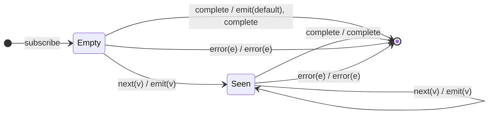

# `defaultIfEmpty` as a Mealy Machine

> `defaultIfEmpty(default)` passes every source value through unchanged, but if
> the source completes **without ever emitting**, it emits a single `default`
> first. The machine is a one-bit memory: a `Empty → Seen` latch, with the
> default firing only on the completion edge out of `Empty`.

Signature:

```ts
defaultIfEmpty<T, R>(defaultValue: R)
```

---

## 1. The 6-Tuple  M = (Q, Σ, Λ, δ, λ, q₀)

### Q — States

- `Empty` — no value seen yet.
- `Seen` — at least one value has passed.
- `Done` — terminal.

### Σ — Input alphabet

- `next(v)`, `complete`, `error(e)`.

### Λ — Output alphabet

- `emit(x)`, `complete`, `error(e)`, `noop`.

### δ, λ

The first value flips `Empty → Seen` and passes through; subsequent values pass
through. On `complete` from `Empty`, the default is emitted; from `Seen`,
completion just forwards.

### q₀ — Initial state

`q₀ = Empty`.

---

## 2. State Transition Table (STT)

| # | State   | Input (Σ)  | Guard       | Next state | Output (λ)                  |
|---|---------|------------|-------------|------------|-----------------------------|
| 1 | `Empty` | `next(v)`  | —           | `Seen`     | `emit(v)`                   |
| 2 | `Seen`  | `next(v)`  | —           | `Seen`     | `emit(v)`                   |
| 3 | `Empty` | `complete` | never saw   | `Done`     | `emit(default)`, `complete` |
| 4 | `Seen`  | `complete` | saw ≥ 1     | `Done`     | `complete`                  |
| 5 | any     | `error(e)` | —           | `Done`     | `error(e)`                  |

Row 3 is the only place the default appears — the completion edge out of `Empty`.

---

## 3. State Transition Diagram (STD)



---

## 4. From STT rows to test cases

- **Rows 1/2** — non-empty source passes through; default never appears.
- **Row 3** — empty source → single `default` then complete.
- **Row 5** — error forwarded (default not emitted).

See [`tests/34-defaultIfEmpty.test.ts`](../../tests/34-defaultIfEmpty.test.ts).

---

## Relationship to the family

`defaultIfEmpty` is the empty-policy engine behind [`first`](first.md),
[`last`](last.md), and [`elementAt`](elementAt.md); `throwIfEmpty` is the same
machine with Row 3 emitting an error instead of the default. See
[`10-filtering-family.md`](../10-filtering-family.md).
