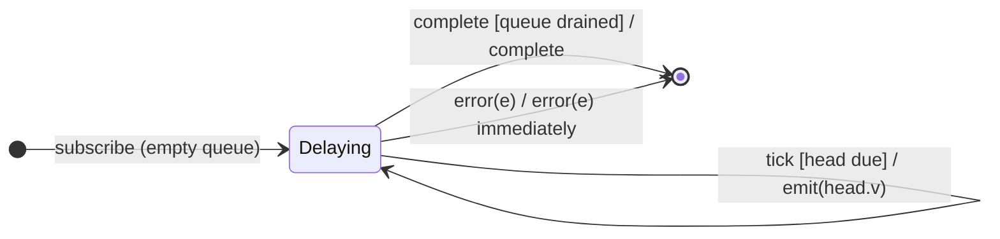

# `delay` as a Mealy Machine

> `delay(d)` shifts every value by `d` milliseconds: each value is held and
> re-emitted `d` later. Completion is delayed too — but **errors are not**; an
> error jumps the queue and fires immediately. The synthetic input symbol is
> `tick` (a scheduled timer firing).

Signature:

```ts
delay<T>(due: number | Date, scheduler?: SchedulerLike)
```

---

## 1. The 6-Tuple  M = (Q, Σ, Λ, δ, λ, q₀)

### Q — States

- `Delaying(queue)` — FIFO of pending `(value, dueTime)` pairs.
- `Done` — terminal.

### Σ — Input alphabet

- `next(v)`, `complete`, `error(e)`, plus `tick` (a pending item's timer fires).

### Λ — Output alphabet

- `emit(x)`, `complete`, `error(e)`, `noop`.

### δ, λ

A `next(v)` enqueues `(v, now+d)` silently; a `tick` releases the due head. The
completion also waits out the queue; an error bypasses it entirely.

### q₀ — Initial state

`q₀ = Delaying([])`.

---

## 2. State Transition Table (STT)

| # | State         | Input      | Guard       | Next / Output                                      |
|---|---------------|------------|-------------|----------------------------------------------------|
| 1 | `Delaying(Q)` | `next(v)`  | —           | enqueue `(v, now+d)`; `noop`                       |
| 2 | `Delaying(Q)` | `tick`     | head is due | dequeue; `emit(head.v)`                            |
| 3 | `Delaying(Q)` | `complete` | —           | after queue drains: `complete` (delayed too)       |
| 4 | `Delaying(Q)` | `error(e)` | —           | `error(e)` **immediately** (errors are NOT delayed)|

Row 4 is the classic gotcha: `delay` postpones `next`/`complete` but not
`error`.

---

## 3. State Transition Diagram (STD)



---

## 4. From STT rows to test cases

- **Rows 1-3** — values and completion shift by `d`.
- **Row 4** — an error fires at once, jumping the delay queue.

See [`tests/60a-delay.test.ts`](../../tests/60a-delay.test.ts).

---

## Relationship to the family

`delay(d)` = [`delayWhen`](delayWhen.md)`(() => timer(d))`. See
[`14-time-family.md`](../14-time-family.md).
