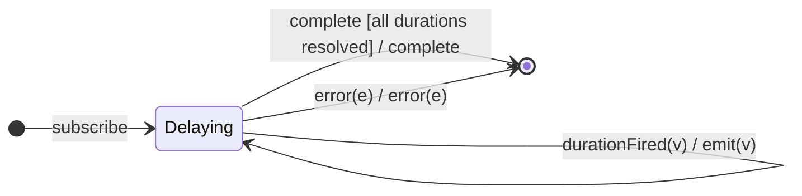

# `delayWhen` as a Mealy Machine

> `delayWhen(durationSelector)` delays each value by the lifetime of a **per-value
> duration observable** `durationSelector(v)`: the value emits when that
> observable first emits (or completes). It is [`delay`](delay.md) with a dynamic
> due-time. Notably, unlike `delay`, it does **not** further delay completion —
> the final value and completion land together once the last per-value duration
> resolves.

Signature:

```ts
delayWhen<T>(delayDurationSelector: (value: T, index: number) => Observable<any>)
```

---

## 1. The 6-Tuple  M = (Q, Σ, Λ, δ, λ, q₀)

### Q — States

- `Delaying(pending)` — set of pending values, each with its own duration inner.
- `Done` — terminal.

### Σ — Input alphabet

- `next(v)`, `complete`, `error(e)`, plus `durationFired_v` (a value's duration
  observable emits/completes).

### Λ — Output alphabet

- `emit(x)`, `complete`, `error(e)`, `noop`.

### δ, λ

Each `next(v)` subscribes `durationSelector(v)` and holds `v` (`noop`). When that
duration fires, `v` is emitted.

### q₀ — Initial state

`q₀ = Delaying(∅)`.

---

## 2. State Transition Table (STT)

| # | State            | Input             | Next / Output                                   |
|---|------------------|-------------------|-------------------------------------------------|
| 1 | `Delaying(P)`    | `next(v)`         | subscribe `durationSelector(v)`; hold `v`; `noop`|
| 2 | `Delaying(P)`    | `durationFired_v` | release `v`; `emit(v)`                          |
| 3 | `Delaying(P)`    | `complete`        | complete once all pending durations resolve     |
| 4 | `Delaying(P)`    | `error(e)`        | `Done`; `error(e)`                              |

---

## 3. State Transition Diagram (STD)



---

## 4. From STT rows to test cases

- **Rows 1-2** — each value is delayed by its duration observable; completion is
  not further delayed beyond the last pending duration.

See [`tests/60b-delayWhen.test.ts`](../../tests/60b-delayWhen.test.ts).

---

## Relationship to the family

`delayWhen` is the duration-selector generalization of [`delay`](delay.md). See
[`14-time-family.md`](../14-time-family.md).
