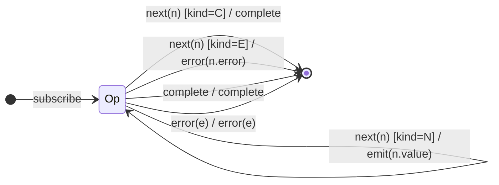

# `dematerialize` as a Mealy Machine

> `dematerialize()` is the inverse of [`materialize`](materialize.md): it reads
> `Notification` objects arriving as source `next` values and **replays them as
> real notifications** downstream. It turns Λ-encoded data back into Σ symbols.

Signature:

```ts
dematerialize<N extends ObservableNotification<any>>(): OperatorFunction<N, ValueFromNotification<N>>
```

---

## 1. The 6-Tuple  M = (Q, Σ, Λ, δ, λ, q₀)

### Q — States

- `Op` — single operational state.
- `Done` — terminal.

### Σ — Input alphabet

- `next(n)` where `n` is a `Notification` of kind `'N'` / `'C'` / `'E'`.
- `complete` (the *outer* source completing).
- `error(e)` (the *outer* source erroring).

### Λ — Output alphabet

- `emit(x)`, `complete`, `error(e)`, `noop`.

### δ, λ

The output depends on the **kind** of the incoming notification `n`:

- `'N'` → emit `n.value`, stay in `Op`.
- `'C'` → complete (go to `Done`).
- `'E'` → error with `n.error` (go to `Done`).

### q₀ — Initial state

`q₀ = Op`.

---

## 2. State Transition Table (STT)

| # | Current state | Input (a Notification n)  | Guard         | Next state | Output (λ)          |
|---|---------------|---------------------------|---------------|------------|---------------------|
| 1 | `Op`          | `next(n)`                 | `n.kind='N'`  | `Op`       | `emit(n.value)`     |
| 2 | `Op`          | `next(n)`                 | `n.kind='C'`  | `Done`     | `complete`          |
| 3 | `Op`          | `next(n)`                 | `n.kind='E'`  | `Done`     | `error(n.error)`    |
| 4 | `Op`          | `complete` (outer source) | —             | `Done`     | `complete`          |
| 5 | `Op`          | `error(e)` (outer source) | —             | `Done`     | `error(e)`          |

Rows 1–3 share the input symbol `next(n)` and fork on `n.kind` — FSM coverage
needs one case per kind.

---

## 3. State Transition Diagram (STD)



---

## 4. From STT rows to test cases

- **Row 1** — `'N'` notifications unwrap to their values.
- **Row 2** — a `'C'` notification triggers downstream completion.
- **Row 3** — an `'E'` notification triggers a downstream error.
- **Round-trip** — `source.pipe(materialize(), dematerialize())` reproduces the
  original stream (identity).

See [`tests/20-dematerialize.test.ts`](../../tests/20-dematerialize.test.ts).

---

## Relationship to the family

`dematerialize` consumes the `Notification` values that
[`materialize`](materialize.md) produces; together they are the reify/replay
pair that closes the transformation family. See
[`09-transformation-family.md`](../09-transformation-family.md).
