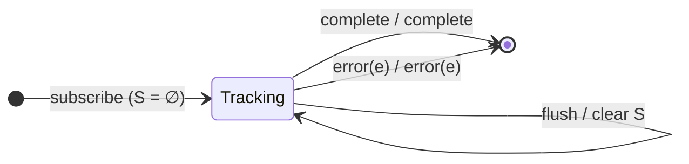

# `distinct` as a Mealy Machine

> `distinct(keySelector?, flushes?)` emits a value only if its key has **never**
> been seen before — a global de-duplication (unlike
> [`distinctUntilChanged`](../02-distinctUntilChanged.md), which only rejects
> *consecutive* duplicates). State is a growing **seen-set**; an optional
> `flushes` stream clears it.

Signature:

```ts
distinct<T, K>(keySelector?: (value: T) => K, flushes?: ObservableInput<any>)
```

---

## 1. The 6-Tuple  M = (Q, Σ, Λ, δ, λ, q₀)

### Q — States

- `Tracking(S)` — `S` is the set of keys seen so far.
- `Done` — terminal.

### Σ — Input alphabet

- `next(v)`, `complete`, `error(e)`, plus `flush` (from the optional `flushes`
  stream).

### Λ — Output alphabet

- `emit(v)`, `complete`, `error(e)`, `noop`.

### δ, λ

A value is emitted and its key added iff the key is new. A `flush` empties the
seen-set (the memory-leak escape hatch).

### q₀ — Initial state

`q₀ = Tracking(∅)`.

---

## 2. State Transition Table (STT)

| # | State         | Input (Σ)  | Guard            | Next state                 | Output (λ) |
|---|---------------|------------|------------------|----------------------------|------------|
| 1 | `Tracking(S)` | `next(v)`  | `key(v) ∉ S`     | `Tracking(S ∪ {key(v)})`   | `emit(v)`  |
| 2 | `Tracking(S)` | `next(v)`  | `key(v) ∈ S`     | `Tracking(S)`              | `noop`     |
| 3 | `Tracking(S)` | `flush`    | flushes emits    | `Tracking(∅)`              | `noop`     |
| 4 | `Tracking(S)` | `complete` | —                | `Done`                     | `complete` |
| 5 | `Tracking(S)` | `error(e)` | —                | `Done`                     | `error(e)` |

Rows 1/2 are the set-membership fork — the defining difference from
`distinctUntilChanged`'s single-value memory.

---

## 3. State Transition Diagram (STD)



---

## 4. From STT rows to test cases

- **Row 1** — new keys pass through.
- **Row 2** — repeated keys (even non-consecutive) are dropped.
- **Row 3** — a `flushes` emission re-admits previously-seen keys.

See [`tests/35-distinct.test.ts`](../../tests/35-distinct.test.ts).

---

## Relationship to the family

`distinct` is the seen-set machine; its consecutive-only cousin is
[`distinctUntilKeyChanged`](distinctUntilKeyChanged.md) /
`distinctUntilChanged`. See
[`11-aggregation-family.md`](../11-aggregation-family.md).
