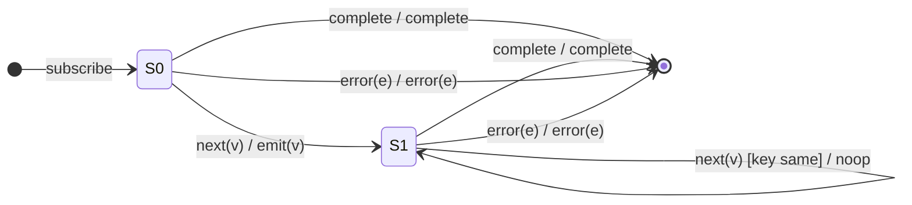

# `distinctUntilKeyChanged` as a Mealy Machine

> `distinctUntilKeyChanged(key, comparator?)` is
> [`distinctUntilChanged`](../02-distinctUntilChanged.md) where the comparison
> runs on `value[key]` instead of the whole value. Same two-state machine: a
> bootstrap state plus "remember the last emitted value," with the guard
> specialised to the chosen property.

Signature:

```ts
distinctUntilKeyChanged<T, K extends keyof T>(key: K, compare?: (a: T[K], b: T[K]) => boolean)
```

---

## 1. The 6-Tuple  M = (Q, Σ, Λ, δ, λ, q₀)

### Q — States

- `S0` — bootstrap: nothing emitted yet.
- `S1(p)` — holding the last emitted value `p`.
- `Done` — terminal.

### Σ — Input alphabet

- `next(v)`, `complete`, `error(e)`.

### Λ — Output alphabet

- `emit(v)`, `complete`, `error(e)`, `noop`.

### δ, λ

The first value is always emitted and becomes `p`. Each subsequent value is
emitted only if `compare(p[key], v[key])` is **false** (key changed); otherwise
it is dropped. The remembered `p` updates to the last **emitted** value.

### q₀ — Initial state

`q₀ = S0`.

---

## 2. State Transition Table (STT)

| # | State   | Input (Σ)  | Guard                            | Next state | Output (λ) |
|---|---------|------------|----------------------------------|------------|------------|
| 1 | `S0`    | `next(v)`  | —                                | `S1(v)`    | `emit(v)`  |
| 2 | `S1(p)` | `next(v)`  | `compare(p[key], v[key])=false`  | `S1(v)`    | `emit(v)`  |
| 3 | `S1(p)` | `next(v)`  | `compare(p[key], v[key])=true`   | `S1(p)`    | `noop`     |
| 4 | any     | `complete` | —                                | `Done`     | `complete` |
| 5 | any     | `error(e)` | —                                | `Done`     | `error(e)` |

Rows 2/3 share the input symbol and fork on the key comparator — both need a
test. Row 1 is the bootstrap edge.

---

## 3. State Transition Diagram (STD)



---

## 4. From STT rows to test cases

- **Row 1** — first value always emitted.
- **Row 2** — a value whose key differs from the last is emitted.
- **Row 3** — a value whose key matches the last is dropped (even if other
  fields differ).

See [`tests/36-distinctUntilKeyChanged.test.ts`](../../tests/36-distinctUntilKeyChanged.test.ts).

---

## Relationship to the family

Same bootstrap-plus-last-value shape as `distinctUntilChanged`; the key-scoped
sibling of the set-based [`distinct`](distinct.md). See
[`11-aggregation-family.md`](../11-aggregation-family.md).
