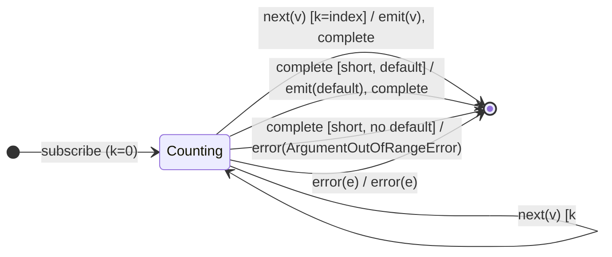

# `elementAt` as a Mealy Machine

> `elementAt(index, default?)` emits the value at position `index` and completes.
> If the source completes before reaching `index`: emits `default` if supplied,
> otherwise **errors with `ArgumentOutOfRangeError`**. A negative `index` throws
> synchronously. Compositionally it is
> `filter((_, n) => n === index) → take(1) → (defaultIfEmpty | throwIfEmpty(ArgumentOutOfRangeError))`.

Signature:

```ts
elementAt<T, D>(index: number, defaultValue?: D)
```

---

## 1. The 6-Tuple  M = (Q, Σ, Λ, δ, λ, q₀)

### Q — States

- `Counting(k)` — `k` values seen so far (`0 ≤ k ≤ index`).
- `Done` — terminal.

### Σ — Input alphabet

- `next(v)`, `complete`, `error(e)`.

### Λ — Output alphabet

- `emit(x)`, `complete`, `error(e)`, `noop`.

### δ, λ

Values are counted and dropped until the `index`-th arrives, which is emitted
and triggers self-completion. If the source completes early, the
out-of-range policy fires.

### q₀ — Initial state

`q₀ = Counting(0)` (assuming `index ≥ 0`; `index < 0` throws at call time).

---

## 2. State Transition Table (STT)

| # | State         | Input (Σ)  | Guard                        | Next state      | Output (λ)                             |
|---|---------------|------------|------------------------------|-----------------|----------------------------------------|
| 1 | `Counting(k)` | `next(v)`  | `k < index`                  | `Counting(k+1)` | `noop`                                 |
| 2 | `Counting(k)` | `next(v)`  | `k = index`                  | `Done`          | `emit(v)`, `complete`                  |
| 3 | `Counting(k)` | `complete` | `k ≤ index`, has default     | `Done`          | `emit(default)`, `complete`            |
| 4 | `Counting(k)` | `complete` | `k ≤ index`, no default      | `Done`          | `error(ArgumentOutOfRangeError)`       |
| 5 | `Counting(k)` | `error(e)` | —                            | `Done`          | `error(e)`                             |

Row 2 self-completes on the target index; Rows 3/4 are the out-of-range fork.

---

## 3. State Transition Diagram (STD)



---

## 4. From STT rows to test cases

- **Row 2** — emits the value at the requested index and completes.
- **Row 3** — index beyond the source + default → emits default.
- **Row 4** — index beyond the source + no default → `ArgumentOutOfRangeError`.

See [`tests/31-elementAt.test.ts`](../../tests/31-elementAt.test.ts).

---

## Relationship to the family

`elementAt` is a positional [`first`](first.md): same `take(1)` self-complete,
but with an index-matching filter and `ArgumentOutOfRangeError` as its empty
policy. See [`10-filtering-family.md`](../10-filtering-family.md).
