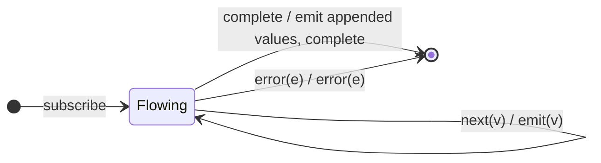

# `endWith` as a Mealy Machine

> `endWith(...values)` passes the source through, then on source completion emits
> the given values and **then** completes. It is `concat(source, of(...values))`
> — the mirror of [`startWith`](startWith.md), adding values on the *complete*
> edge instead of the *subscribe* edge. An errored source skips the appended
> tail entirely.

Signature:

```ts
endWith<T>(...values: T[])
```

---

## 1. The 6-Tuple  M = (Q, Σ, Λ, δ, λ, q₀)

### Q — States

- `Flowing` — passing the source through.
- `Done` — terminal.

### Σ — Input alphabet

- `next(v)`, `complete`, `error(e)`.

### Λ — Output alphabet

- `emit(x)`, `complete`, `error(e)`, `noop`.

### δ, λ

Source values pass through unchanged. On `complete`, the appended values are
emitted, then completion. On `error`, the appended values are **not** emitted.

### q₀ — Initial state

`q₀ = Flowing`.

---

## 2. State Transition Table (STT)

| # | State     | Input (Σ)  | Next state | Output (λ)                                   |
|---|-----------|------------|------------|----------------------------------------------|
| 1 | `Flowing` | `next(v)`  | `Flowing`  | `emit(v)`                                    |
| 2 | `Flowing` | `complete` | `Done`     | `emit(w0) … emit(wk)`, then `complete`       |
| 3 | `Flowing` | `error(e)` | `Done`     | `error(e)` (appended values NOT emitted)     |

Row 3 shows the asymmetry: an errored source discards the `endWith` tail.

---

## 3. State Transition Diagram (STD)



---

## 4. From STT rows to test cases

- **Row 1** — source values pass through unchanged.
- **Row 2** — appended values appear after the source completes, then
  completion.
- **Row 3** — an errored source does **not** emit the appended tail.

See [`tests/48-endWith.test.ts`](../../tests/48-endWith.test.ts).

---

## Relationship to the family

`endWith` appends on the complete edge; [`startWith`](startWith.md) prepends on
the subscribe edge. See
[`11-aggregation-family.md`](../11-aggregation-family.md).
