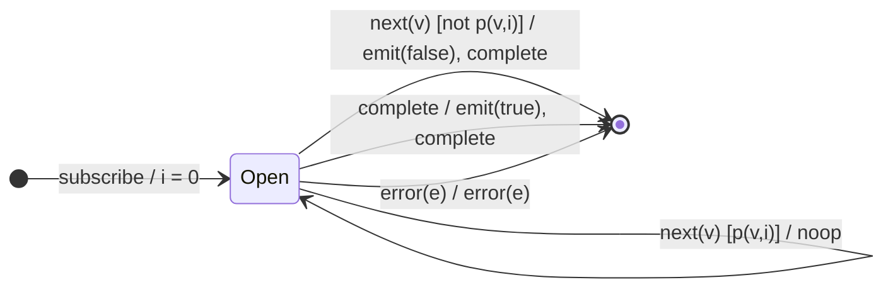

# `every` as a Mealy Machine

> `every(predicate)` is the **universal quantifier**: it emits a single boolean —
> `true` if every value satisfies the predicate, `false` the moment one fails.
> The `false` verdict **short-circuits** (emitted before completion); the `true`
> verdict waits for completion (and is vacuously `true` for an empty source).

Signature:

```ts
every<T>(predicate: (value: T, index: number) => boolean)
```

---

## 1. The 6-Tuple  M = (Q, Σ, Λ, δ, λ, q₀)

### Q — States

- `Open` — all values so far have passed.
- `Done` — terminal.

### Σ — Input alphabet

- `next(v)`, `complete`, `error(e)`.

### Λ — Output alphabet

- `emit(boolean)`, `complete`, `error(e)`, `noop`.

### δ, λ

While values pass, `noop`. The first failing value emits `false` and completes
immediately. If the source completes with no failure, emit `true`.

### q₀ — Initial state

`q₀ = Open`, index `i = 0`.

---

## 2. State Transition Table (STT)

| # | State  | Input (Σ)  | Guard          | Next   | Output (λ)                              |
|---|--------|------------|----------------|--------|-----------------------------------------|
| 1 | `Open` | `next(v)`  | `p(v,i)=true`  | `Open` | `noop` (still all-true)                 |
| 2 | `Open` | `next(v)`  | `p(v,i)=false` | `Done` | `emit(false)`, `complete` (short-circuit)|
| 3 | `Open` | `complete` | —              | `Done` | `emit(true)`, `complete` (vacuous if empty)|
| 4 | `Open` | `error(e)` | —              | `Done` | `error(e)`                              |

Row 2 is the short-circuit: the first failing value decides `false` right away.

---

## 3. State Transition Diagram (STD)



---

## 4. From STT rows to test cases

- **Row 2** — a failing value emits `false` immediately, before source
  completion.
- **Row 3 (all pass)** — emits `true` on completion.
- **Row 3 (empty)** — empty source emits `true` (vacuous truth).

See [`tests/37-every.test.ts`](../../tests/37-every.test.ts).

---

## Relationship to the family

`every` is the mirror of [`isEmpty`](isEmpty.md): `every` short-circuits to
`false` on a failing value; `isEmpty` short-circuits to `false` on *any* value.
Both are short-circuit existence machines. See
[`11-aggregation-family.md`](../11-aggregation-family.md).
