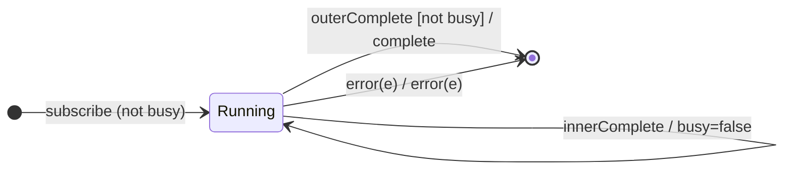

# `exhaustAll` as a Mealy Machine

> `exhaustAll()` flattens a higher-order Observable but **ignores new inners
> while one is still active** (first wins until it finishes). It is
> `exhaustMap(identity)` — the **exhaust policy** with identity projection.
> `exhaust()` is a deprecated alias.

Signature:

```ts
exhaustAll<T>()
```

---

## 1. The 6-Tuple  M = (Q, Σ, Λ, δ, λ, q₀)

Identical skeleton to [`exhaustMap`](exhaustMap.md) with `project = identity`.

### Q — States

- `Running(busy, cur?, outerDone)`, `Done`.

### δ, λ

Each `outerNext(inner)` subscribes `inner` only if not busy; otherwise the inner
is dropped. Inner values forward; inner completion clears `busy`. `q₀ =
Running(false, ∅, false)`.

---

## 2. State Transition Table (STT)

| # | State                   | Input               | Guard        | Next / Output                       |
|---|-------------------------|---------------------|--------------|-------------------------------------|
| U1| `Running(b,c,_)`        | `innerNext(x)`      | —            | `emit(x)`                           |
| E1| `Running(false,∅,_)`    | `outerNext(inner)`  | `busy=false` | subscribe `inner`; `busy=true`; `noop`|
| E2| `Running(true,c,_)`     | `outerNext(inner)`  | `busy=true`  | **drop `inner`**; `noop`            |
| E3| `Running(true,c,_)`     | `innerComplete`     | —            | `busy=false`; `noop`                |
| U4| `Running(false,∅,true)` | (inner done)        | outer done   | `complete`                          |
| U2/U3| `Running(b,c,_)`     | inner/outer error   | —            | `error(e)` → `Done`                 |

---

## 3. State Transition Diagram (STD)



---

## 4. From STT rows to test cases

- **E1 + E2** — the first inner runs to completion; inners arriving during that
  window are dropped.

See [`tests/53d-exhaustAll.test.ts`](../../tests/53d-exhaustAll.test.ts).

---

## Relationship to the family

`exhaustAll()` = [`exhaustMap`](exhaustMap.md)`(identity)`;
[`exhaust`](exhaust.md) is a deprecated alias. See
[`12-flattening-family.md`](../12-flattening-family.md).
