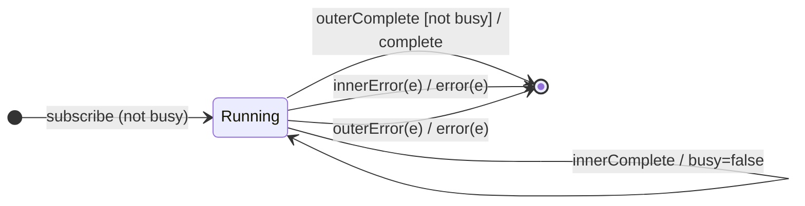

# `exhaustMap` as a Mealy Machine

> `exhaustMap(project)` maps each source value to an inner Observable, but
> **ignores new source values while an inner is still running**. The **exhaust
> policy** = *drop the new*. It is the dual of [`switchMap`](switchMap.md):
> switch drops the old inner for the new value; exhaust drops the new value to
> protect the old inner. Ideal for debouncing repeated submit clicks.

Signature:

```ts
exhaustMap<T, R>(project: (value: T, index: number) => ObservableInput<R>)
```

---

## 1. The 6-Tuple  M = (Q, Σ, Λ, δ, λ, q₀)

### Q — States

- `Running(busy, cur?, outerDone)` — a busy flag (an inner is active), the
  current inner, and whether the outer completed.
- `Done` — terminal.

### Σ — Input alphabet

- Outer: `outerNext(v)`, `outerComplete`, `outerError(e)`.
- Inner: `innerNext(x)`, `innerComplete`, `innerError(e)`.

### Λ — Output alphabet

- `emit(x)`, `complete`, `error(e)`, `noop`.

### δ, λ

Inner values forward. A source value starts an inner only if not busy; otherwise
it is **dropped** (not queued, not switched). When the inner completes, `busy`
clears.

### q₀ — Initial state

`q₀ = Running(false, ∅, false)`.

---

## 2. State Transition Table (STT)

| # | State                   | Input           | Guard        | Next state / Output                         |
|---|-------------------------|-----------------|--------------|---------------------------------------------|
| U1| `Running(b,c,_)`        | `innerNext(x)`  | —            | `emit(x)`                                   |
| E1| `Running(false,∅,_)`    | `outerNext(v)`  | `busy=false` | subscribe `project(v)`; `busy=true`; `noop` |
| E2| `Running(true,c,_)`     | `outerNext(v)`  | `busy=true`  | **drop `v`**; `noop`                        |
| E3| `Running(true,c,_)`     | `innerComplete` | —            | `busy=false`; `cur := ∅`; `noop`            |
| U4| `Running(false,∅,true)` | (inner done)    | outer done   | `complete`                                  |
| U2| `Running(b,c,_)`        | `innerError(e)` | —            | `error(e)` → `Done`                         |
| U3| `Running(b,c,_)`        | `outerError(e)` | —            | `error(e)` → `Done`                         |

E2 is the defining edge: a value arriving while busy is silently discarded.

---

## 3. State Transition Diagram (STD)



---

## 4. From STT rows to test cases

- **E1 + E2** — the first value's inner runs to completion; values arriving
  during that window are dropped entirely.

See [`tests/52-exhaustMap.test.ts`](../../tests/52-exhaustMap.test.ts).

---

## Relationship to the family

[`exhaustAll`](exhaustAll.md)/[`exhaust`](exhaust.md) are
`exhaustMap(identity)`. The exhaust policy *drops the new*, the dual of
[`switchMap`](switchMap.md)'s *cancel the old*. See
[`12-flattening-family.md`](../12-flattening-family.md).
