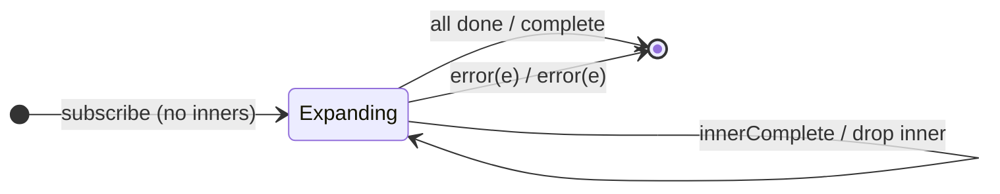

# `expand` as a Mealy Machine

> `expand(project, concurrent?)` is like `mergeMap`, but each inner emission is
> **fed back as a new input** to `project`, recursively, breadth-first. Every
> value is both **output** and **re-projected**. It is a fixed-point/BFS
> generator — `mergeMap` with its output wired back into its input — and must be
> bounded (the project function must eventually yield `EMPTY`) or it never
> completes.

Signature:

```ts
expand<T, R>(project: (value: T, index: number) => ObservableInput<R>, concurrent = Infinity)
```

---

## 1. The 6-Tuple  M = (Q, Σ, Λ, δ, λ, q₀)

### Q — States

- `Expanding(actives)` — the set of active inner subscriptions (same
  inner-subscription bookkeeping as `mergeMap`, Session 6).
- `Done` — terminal.

### Σ — Input alphabet

- Outer: `next(v)`, `complete`, `error(e)`.
- Inner: `innerNext(x)`, `innerComplete_i`, `innerError(e)`.

### Λ — Output alphabet

- `emit(x)`, `complete`, `error(e)`, `noop`.

### δ, λ

Each source value is emitted **and** projected. Crucially, each **inner
emission** is treated as a new input: it is emitted **and** re-projected
(the recursion). Output completes when source and all inners finish.

### q₀ — Initial state

`q₀ = Expanding(∅)`.

---

## 2. State Transition Table (STT)

| # | State           | Input (outer or inner feedback) | Next / Output                                   |
|---|-----------------|---------------------------------|-------------------------------------------------|
| 1 | `Expanding(A)`  | `next(v)`                       | `emit(v)`; subscribe `project(v)`; `A ∪ {i}`    |
| 2 | `Expanding(A)`  | `innerNext(x)`                  | treat `x` as a new input → **`emit(x)` AND re-project(x)** |
| 3 | `Expanding(A)`  | `innerComplete_i`               | `A \ {i}`; `noop`                               |
| 4 | `Expanding(∅)`  | all done                        | `Done`; `complete`                              |
| 5 | any             | `error(e)`                      | `Done`; `error(e)`                              |

Row 2 is the defining edge: an inner emission is both forwarded and recursively
re-fed.

---

## 3. State Transition Diagram (STD)



---

## 4. From STT rows to test cases

- **Row 2** — breadth-first recursion: each emission is both output and re-fed;
  bounded by an `EMPTY` base case (or `take`) so it terminates.

See [`tests/73-expand.test.ts`](../../tests/73-expand.test.ts).

---

## Relationship to the family

`expand` is `mergeMap` (Session 6) with the output wired back into the input — a
recursive flatten. See
[`15-buffering-windowing-family.md`](../15-buffering-windowing-family.md).
