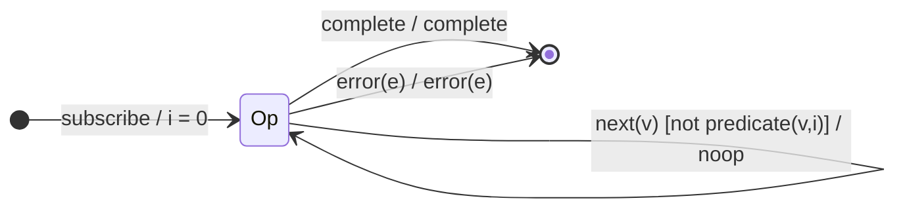

# `filter` as a Mealy Machine

> `filter(predicate)` forwards only the source values for which the predicate is
> truthy and drops the rest. It is the first *guarded* projector in the family:
> its `next` edge forks on the predicate, so one input symbol produces two
> possible outputs (`emit` or `noop`).

Signature:

```ts
filter<T>(predicate: (value: T, index: number) => boolean)
```

---

## 1. The 6-Tuple  M = (Q, Σ, Λ, δ, λ, q₀)

### Q — States

- `Op` — single operational state (no memory beyond the index counter).
- `Done` — terminal.

### Σ — Input alphabet

- `next(v)`, `complete`, `error(e)`.

### Λ — Output alphabet

- `emit(v)`, `complete`, `error(e)`, `noop`.

### δ, λ

`δ(Op, next) = Op` regardless of the predicate. The **output** forks:
`λ = emit(v)` when `predicate(v, i)` is truthy, else `noop`. The state never
changes on the fork — this is a pure Mealy output guard.

### q₀ — Initial state

`q₀ = Op`, index `i = 0`.

---

## 2. State Transition Table (STT)

| # | Current state | Input (Σ)  | Guard               | Next state | Output (λ) |
|---|---------------|------------|---------------------|------------|------------|
| 1 | `Op`          | `next(v)`  | `predicate(v,i)`    | `Op`       | `emit(v)`  |
| 2 | `Op`          | `next(v)`  | `!predicate(v,i)`   | `Op`       | `noop`     |
| 3 | `Op`          | `complete` | —                   | `Done`     | `complete` |
| 4 | `Op`          | `error(e)` | —                   | `Done`     | `error(e)` |

Rows 1 and 2 are the guard fork — FSM coverage demands one guard-true and one
guard-false test.

---

## 3. State Transition Diagram (STD)



---

## 4. From STT rows to test cases

- **Row 1** — values passing the predicate are forwarded unchanged.
- **Row 2** — values failing the predicate are dropped (the marble gap proves
  the `noop`).
- **Row 3 / Row 4** — completion / error forwarded.

See [`tests/12-filter.test.ts`](../../tests/12-filter.test.ts).

---

## Relationship to the family

`filter` is the single-state projector with a **guarded output** — the simplest
machine whose `λ` depends on a predicate rather than always emitting. See
[`09-transformation-family.md`](../09-transformation-family.md).
