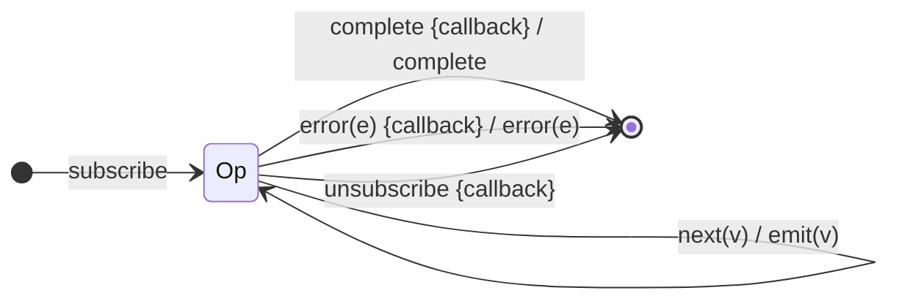

# `finalize` as a Mealy Machine

> `finalize(callback)` is an **identity value machine** with one guarantee: the
> `callback` runs on **any** termination — complete, error, or unsubscription.
> It is a Mealy "exit action" attached to every edge leaving the operational
> state; it never changes Λ.

Signature:

```ts
finalize<T>(callback: () => void)
```

---

## 1. The 6-Tuple  M = (Q, Σ, Λ, δ, λ, q₀)

### Q — States

- `Op` — single operational state.
- `Done` — terminal (or torn down).

### Σ — Input alphabet

- `next(v)`, `complete`, `error(e)`, plus `unsubscribe`.

### Λ — Output alphabet

- `emit(v)`, `complete`, `error(e)` — unchanged from the source.

### δ, λ

Values and terminals pass through unchanged; the only addition is running
`callback` on the transition **into** the terminal/torn-down state.

### q₀ — Initial state

`q₀ = Op`.

---

## 2. State Transition Table (STT)

| # | State | Input        | Side-effect   | Output (λ)   |
|---|-------|--------------|---------------|--------------|
| 1 | `Op`  | `next(v)`    | —             | `emit(v)`    |
| 2 | `Op`  | `complete`   | run callback  | `complete`   |
| 3 | `Op`  | `error(e)`   | run callback  | `error(e)`   |
| 4 | `Op`  | `unsubscribe`| run callback  | (teardown)   |

The callback fires on every edge leaving `Op`; it is independent of the output.

---

## 3. State Transition Diagram (STD)



(`{callback}` is the exit action fired on the edge.)

---

## 4. From STT rows to test cases

- **Row 2** — callback runs on completion.
- **Row 3** — callback runs on error.

See [`tests/74c-finalize.test.ts`](../../tests/74c-finalize.test.ts).

---

## Relationship to the family

`finalize` is the teardown-edge operator — an identity machine with a guaranteed
exit action. See
[`16-error-repeat-multicast-family.md`](../16-error-repeat-multicast-family.md).
