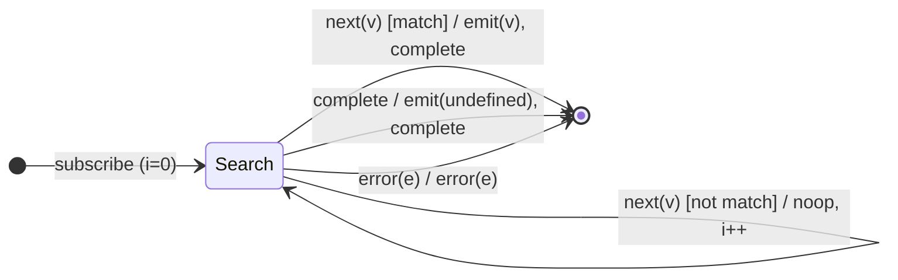

# `find` as a Mealy Machine

> `find(predicate)` is the **existential quantifier**: it emits the **first
> value** matching the predicate and completes; if none matches, it emits
> `undefined` on completion. The match **short-circuits** (emitted before source
> completion).

Signature:

```ts
find<T>(predicate: (value: T, index: number) => boolean)
```

---

## 1. The 6-Tuple  M = (Q, Σ, Λ, δ, λ, q₀)

### Q — States

- `Search(i)` — scanning at index `i`, no match yet.
- `Done` — terminal.

### Σ — Input alphabet

- `next(v)`, `complete`, `error(e)`.

### Λ — Output alphabet

- `emit(x)`, `complete`, `error(e)`, `noop`.

### δ, λ

Non-matching values advance the index silently. The first match emits the value
and completes. Completion with no match emits `undefined`.

### q₀ — Initial state

`q₀ = Search(0)`.

---

## 2. State Transition Table (STT)

| # | State       | Input (Σ)  | Guard          | Next        | Output (λ)                       |
|---|-------------|------------|----------------|-------------|----------------------------------|
| 1 | `Search(i)` | `next(v)`  | `p(v,i)=false` | `Search(i+1)`| `noop`                          |
| 2 | `Search(i)` | `next(v)`  | `p(v,i)=true`  | `Done`      | `emit(v)`, `complete` (short-circuit)|
| 3 | `Search(i)` | `complete` | —              | `Done`      | `emit(undefined)`, `complete`    |
| 4 | `Search(i)` | `error(e)` | —              | `Done`      | `error(e)`                       |

---

## 3. State Transition Diagram (STD)



---

## 4. From STT rows to test cases

- **Row 2** — the first matching value is emitted immediately, then complete.
- **Row 3** — no match → `undefined` on completion.

See [`tests/38-find.test.ts`](../../tests/38-find.test.ts).

---

## Relationship to the family

`find` and [`findIndex`](findIndex.md) are the same machine with different output
projections: `find` emits the value (or `undefined`), `findIndex` emits the
index (or `-1`). See
[`11-aggregation-family.md`](../11-aggregation-family.md).
