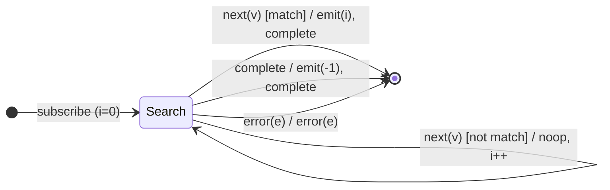

# `findIndex` as a Mealy Machine

> `findIndex(predicate)` emits the **index** of the first value matching the
> predicate and completes; if none matches, it emits `-1` on completion. It is
> [`find`](find.md) with the output projected to the index instead of the value
> — the same machine, a different `λ`.

Signature:

```ts
findIndex<T>(predicate: (value: T, index: number) => boolean)
```

---

## 1. The 6-Tuple  M = (Q, Σ, Λ, δ, λ, q₀)

### Q — States

- `Search(i)` — scanning at index `i`, no match yet.
- `Done` — terminal.

### Σ — Input alphabet

- `next(v)`, `complete`, `error(e)`.

### Λ — Output alphabet

- `emit(number)`, `complete`, `error(e)`, `noop`.

### δ, λ

Non-matching values advance the index silently. The first match emits its index
`i` and completes. Completion with no match emits `-1`.

### q₀ — Initial state

`q₀ = Search(0)`.

---

## 2. State Transition Table (STT)

| # | State       | Input (Σ)  | Guard          | Next         | Output (λ)                       |
|---|-------------|------------|----------------|--------------|----------------------------------|
| 1 | `Search(i)` | `next(v)`  | `p(v,i)=false` | `Search(i+1)`| `noop`                           |
| 2 | `Search(i)` | `next(v)`  | `p(v,i)=true`  | `Done`       | `emit(i)`, `complete` (short-circuit)|
| 3 | `Search(i)` | `complete` | —              | `Done`       | `emit(-1)`, `complete`           |
| 4 | `Search(i)` | `error(e)` | —              | `Done`       | `error(e)`                       |

---

## 3. State Transition Diagram (STD)



---

## 4. From STT rows to test cases

- **Row 2** — the index of the first match is emitted immediately.
- **Row 3** — no match → `-1` on completion.

See [`tests/39-findIndex.test.ts`](../../tests/39-findIndex.test.ts).

---

## Relationship to the family

Identical δ to [`find`](find.md); only the output function differs (index vs.
value, `-1` vs. `undefined`). A clean "same machine, different λ" pair. See
[`11-aggregation-family.md`](../11-aggregation-family.md).
