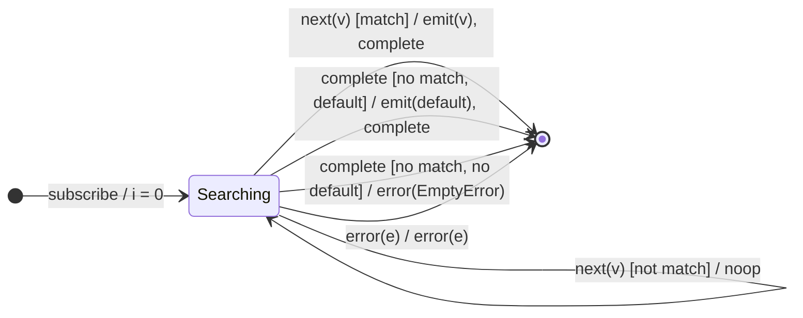

# `first` as a Mealy Machine

> `first(predicate?, default?)` emits the **first** value (optionally the first
> matching a predicate) and completes. If none matches: emits `default` if
> supplied, otherwise **errors with `EmptyError`**. Compositionally it is
> `filter(p?) → take(1) → (defaultIfEmpty | throwIfEmpty(EmptyError))`.

Signature:

```ts
first<T, D>(predicate?: (value: T, index: number) => boolean, defaultValue?: D)
```

---

## 1. The 6-Tuple  M = (Q, Σ, Λ, δ, λ, q₀)

### Q — States

- `Searching` — no matching value seen yet.
- `Done` — terminal.

### Σ — Input alphabet

- `next(v)`, `complete`, `error(e)`.

### Λ — Output alphabet

- `emit(x)`, `complete`, `error(e)`, `noop`.

### δ, λ

The first value satisfying the predicate (or any value, predicate-less) is
emitted and the machine self-completes. On `complete` with no match, the empty
policy fires: default-or-`EmptyError`.

### q₀ — Initial state

`q₀ = Searching`, index `i = 0`.

---

## 2. State Transition Table (STT)

| # | State       | Input (Σ)  | Guard                      | Next state  | Output (λ)                        |
|---|-------------|------------|----------------------------|-------------|-----------------------------------|
| 1 | `Searching` | `next(v)`  | `p(v,i)` (or no predicate) | `Done`      | `emit(v)`, `complete`             |
| 2 | `Searching` | `next(v)`  | `!p(v,i)`                  | `Searching` | `noop`                            |
| 3 | `Searching` | `complete` | no match, has default      | `Done`      | `emit(default)`, `complete`       |
| 4 | `Searching` | `complete` | no match, no default       | `Done`      | `error(EmptyError)`               |
| 5 | `Searching` | `error(e)` | —                          | `Done`      | `error(e)`                        |

Row 1 self-completes on the first match (the `take(1)` behaviour); Rows 3/4 are
the empty-policy fork.

---

## 3. State Transition Diagram (STD)



---

## 4. From STT rows to test cases

- **Row 1** — emits the first value (or first match) and completes.
- **Row 3** — no match + default → emits default.
- **Row 4** — no match + no default → `EmptyError`.

See [`tests/29-first.test.ts`](../../tests/29-first.test.ts).

---

## Relationship to the family

`first` = `filter → take(1) →` empty-policy. Its completion-side counterpart is
[`last`](last.md); both share the default-or-`EmptyError` policy driven by
[`defaultIfEmpty`](defaultIfEmpty.md)/`throwIfEmpty`. See
[`10-filtering-family.md`](../10-filtering-family.md).
