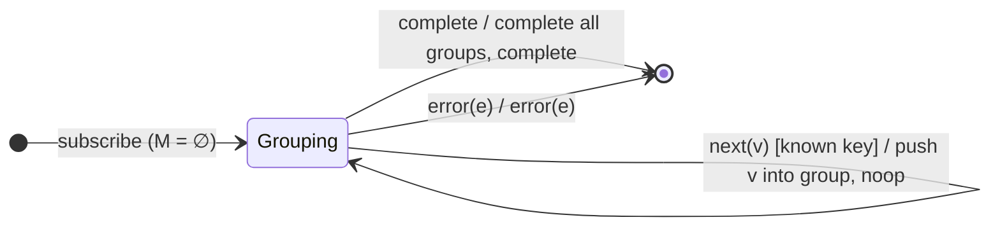

# `groupBy` as a Mealy Machine

> `groupBy(keySelector, options?)` partitions the source into multiple
> sub-streams, one per distinct key. Each distinct key spawns a
> `GroupedObservable` (a Subject tagged with its `key`); subsequent values with
> that key are routed into the matching group. Structurally it is `distinct`'s
> seen-set (Session 5) crossed with `window`'s Subject-per-group.

Signature:

```ts
groupBy<T, K>(keySelector: (value: T) => K, options?)
```

---

## 1. The 6-Tuple  M = (Q, Σ, Λ, δ, λ, q₀)

### Q — States

- `Grouping(M)` — a map `key → Subject` of active groups.
- `Done` — terminal.

### Σ — Input alphabet

- `next(v)`, `complete`, `error(e)`.

### Λ — Output alphabet

- `emit(GroupedObservable)` (a **new** group) plus inner `next`/`complete` on
  each group Subject; `complete`, `error(e)`.

### δ, λ

A value with a **new** key creates a group Subject, emits it downstream, and
pushes the value into it. A value with a **known** key is routed silently into
its existing group (no new group emitted).

### q₀ — Initial state

`q₀ = Grouping(∅)`.

---

## 2. State Transition Table (STT)

| # | State          | Input      | Guard        | Next / Output                                               |
|---|----------------|------------|--------------|-------------------------------------------------------------|
| 1 | `Grouping(M)`  | `next(v)`  | `key(v) ∉ M` | create Subject g; `M[key]:=g`; push v into g; `emit(g)`     |
| 2 | `Grouping(M)`  | `next(v)`  | `key(v) ∈ M` | push v into `M[key]`; `noop` (no new group out)             |
| 3 | `Grouping(M)`  | `complete` | —            | complete every group **and** the output; `complete`        |
| 4 | `Grouping(M)`  | `error(e)` | —            | error every group and the output; `error(e)`               |

Rows 1/2 fork on "seen this key before?": a new key emits a new group
observable; a known key silently routes the value.

---

## 3. State Transition Diagram (STD)



---

## 4. From STT rows to test cases

- **Rows 1/2** — a new group observable is emitted per distinct key; values
  route correctly into their group (flatten each group with `toArray`).

See [`tests/72-groupBy.test.ts`](../../tests/72-groupBy.test.ts).

---

## Relationship to the family

`groupBy` combines `distinct`'s seen-set (Session 5) with a Subject-per-group — a
keyed partition. See
[`15-buffering-windowing-family.md`](../15-buffering-windowing-family.md).
