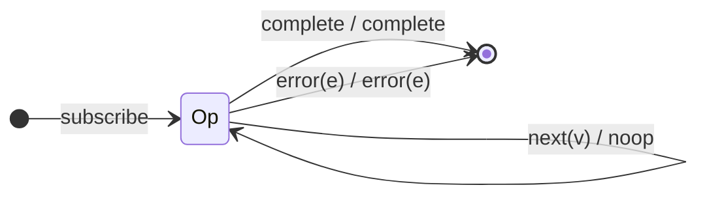

# `ignoreElements` as a Mealy Machine

> `ignoreElements()` swallows **all** values and forwards only the terminal
> notification (`complete` or `error`). It is the purest "`λ = noop` on `next`"
> machine — it keeps nothing but the completion/error channel.

Signature:

```ts
ignoreElements()
```

---

## 1. The 6-Tuple  M = (Q, Σ, Λ, δ, λ, q₀)

### Q — States

- `Op` — single operational state.
- `Done` — terminal.

### Σ — Input alphabet

- `next(v)`, `complete`, `error(e)`.

### Λ — Output alphabet

- `complete`, `error(e)`, `noop`. (No `emit` is ever produced.)

### δ, λ

Every `next(v)` is dropped (`noop`). Only the terminal notifications pass.

### q₀ — Initial state

`q₀ = Op`.

---

## 2. State Transition Table (STT)

| # | State | Input (Σ)  | Next state | Output (λ) |
|---|-------|------------|------------|------------|
| 1 | `Op`  | `next(v)`  | `Op`       | `noop`     |
| 2 | `Op`  | `complete` | `Done`     | `complete` |
| 3 | `Op`  | `error(e)` | `Done`     | `error(e)` |

---

## 3. State Transition Diagram (STD)



---

## 4. From STT rows to test cases

- **Row 1** — no values reach the output (the marble has no value frames).
- **Row 2** — completion passes through.
- **Row 3** — error passes through.

See [`tests/33-ignoreElements.test.ts`](../../tests/33-ignoreElements.test.ts).

---

## Relationship to the family

`ignoreElements` keeps *only* the terminal — the spiritual dual of
[`materialize`](materialize.md), which keeps *everything* as data. See
[`10-filtering-family.md`](../10-filtering-family.md).
