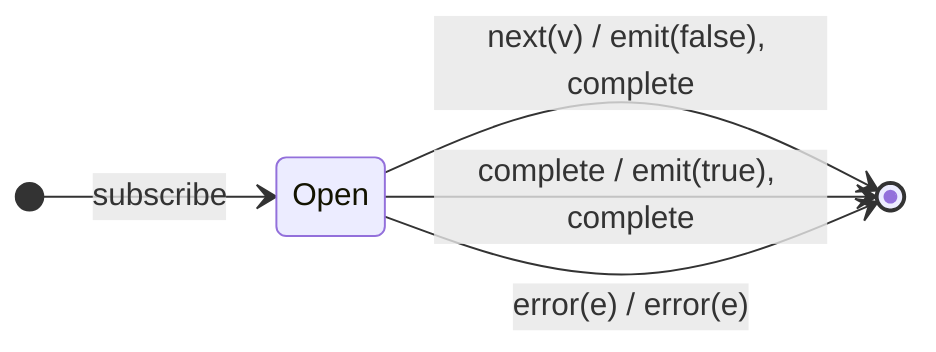

# `isEmpty` as a Mealy Machine

> `isEmpty()` emits a single boolean: `false` the moment **any** value arrives
> (short-circuit), or `true` if the source completes without emitting. It is the
> 1-bit existence check — the mirror of [`every`](every.md).

Signature:

```ts
isEmpty()
```

---

## 1. The 6-Tuple  M = (Q, Σ, Λ, δ, λ, q₀)

### Q — States

- `Open` — no value seen yet.
- `Done` — terminal.

### Σ — Input alphabet

- `next(v)`, `complete`, `error(e)`.

### Λ — Output alphabet

- `emit(boolean)`, `complete`, `error(e)`.

### δ, λ

The first value decides `false` and completes immediately. Completion with no
value decides `true`.

### q₀ — Initial state

`q₀ = Open`.

---

## 2. State Transition Table (STT)

| # | State  | Input (Σ)  | Next   | Output (λ)                                    |
|---|--------|------------|--------|-----------------------------------------------|
| 1 | `Open` | `next(v)`  | `Done` | `emit(false)`, `complete` (short-circuit)     |
| 2 | `Open` | `complete` | `Done` | `emit(true)`, `complete`                      |
| 3 | `Open` | `error(e)` | `Done` | `error(e)`                                    |

---

## 3. State Transition Diagram (STD)



---

## 4. From STT rows to test cases

- **Row 1** — a non-empty source emits `false` on its first value, then
  completes.
- **Row 2** — an empty source emits `true` on completion.

See [`tests/40-isEmpty.test.ts`](../../tests/40-isEmpty.test.ts).

---

## Relationship to the family

`isEmpty` is `every`'s mirror: `every` short-circuits to `false` on the first
*failing* value; `isEmpty` short-circuits to `false` on the first value of any
kind. See [`11-aggregation-family.md`](../11-aggregation-family.md).
