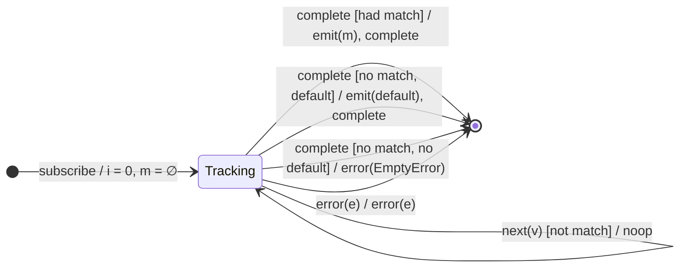

# `last` as a Mealy Machine

> `last(predicate?, default?)` emits the **last** value (optionally the last
> matching a predicate) **on completion**. If none matches: emits `default` if
> supplied, otherwise **errors with `EmptyError`**. Compositionally it is
> `filter(p?) → takeLast(1) → (defaultIfEmpty | throwIfEmpty(EmptyError))`.

Signature:

```ts
last<T, D>(predicate?: (value: T, index: number) => boolean, defaultValue?: D)
```

---

## 1. The 6-Tuple  M = (Q, Σ, Λ, δ, λ, q₀)

### Q — States

- `Tracking(lastMatch?)` — remembers the most recent matching value, if any.
- `Done` — terminal.

### Σ — Input alphabet

- `next(v)`, `complete`, `error(e)`.

### Λ — Output alphabet

- `emit(x)`, `complete`, `error(e)`, `noop`.

### δ, λ

Each matching value **overwrites** the remembered candidate (always `noop` —
nothing emits during the run). On `complete`, the remembered candidate is
emitted; if there is none, the empty policy fires.

### q₀ — Initial state

`q₀ = Tracking(∅)`, index `i = 0`.

---

## 2. State Transition Table (STT)

| # | State               | Input (Σ)  | Guard                      | Next state        | Output (λ)                  |
|---|---------------------|------------|----------------------------|-------------------|-----------------------------|
| 1 | `Tracking(m)`       | `next(v)`  | `p(v,i)` (or no predicate) | `Tracking(v)`     | `noop`                      |
| 2 | `Tracking(m)`       | `next(v)`  | `!p(v,i)`                  | `Tracking(m)`     | `noop`                      |
| 3 | `Tracking(m≠∅)`     | `complete` | had a match                | `Done`            | `emit(m)`, `complete`       |
| 4 | `Tracking(∅)`       | `complete` | no match, has default      | `Done`            | `emit(default)`, `complete` |
| 5 | `Tracking(∅)`       | `complete` | no match, no default       | `Done`            | `error(EmptyError)`         |
| 6 | `Tracking(m)`       | `error(e)` | —                          | `Done`            | `error(e)`                  |

Row 1 overwrites the candidate; Row 3 flushes it on completion.

---

## 3. State Transition Diagram (STD)



---

## 4. From STT rows to test cases

- **Rows 1+3** — the last (matching) value is emitted on completion.
- **Row 4** — no match + default → emits default.
- **Row 5** — no match + no default → `EmptyError`.

See [`tests/30-last.test.ts`](../../tests/30-last.test.ts).

---

## Relationship to the family

`last` = `filter → takeLast(1) →` empty-policy — the completion-side counterpart
of [`first`](first.md). See
[`10-filtering-family.md`](../10-filtering-family.md).
