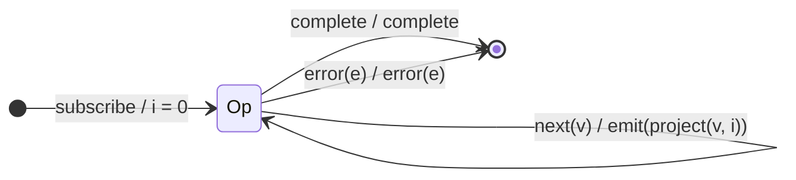

# `map` as a Mealy Machine

> `map(project)` applies a projection function to every source value and emits
> the result. It is the purest *stateless projector*: it keeps no memory
> between notifications, so all of its behaviour lives in the output function
> `λ`, not in the state structure.

Signature used in this analysis:

```ts
map<T, R>(project: (value: T, index: number) => R)
```

The `index` is a zero-based counter of how many values have passed through this
operator; it is threaded by the operator itself (not source state), so it does
**not** make `map` stateful in the behavioural sense — it is passed to `project`
as a convenience.

---

## 1. The 6-Tuple  M = (Q, Σ, Λ, δ, λ, q₀)

### Q — States

- `Op` — the single operational state. `map` remembers nothing that affects the
  machine's *behaviour*; the index counter is incidental bookkeeping.
- `Done` — terminal state after `complete` or `error`.

### Σ — Input alphabet

- `next(v)` — a source value.
- `complete` — source completed.
- `error(e)` — source errored.

### Λ — Output alphabet

- `emit(x)` — emit a projected value.
- `complete` — forward completion.
- `error(e)` — forward error.
- `noop` — emit nothing on this transition.

### δ, λ — Transition & Output functions

This is a **Mealy** machine: the output is attached to the **transition**. On
every `next(v)` the machine stays in `Op` (`δ(Op, next) = Op`) and emits exactly
one value `project(v, i)` **in the same step** (`λ`).

### q₀ — Initial state

`q₀ = Op`, index `i = 0`.

---

## 2. State Transition Table (STT)

| # | Current state | Input (Σ)  | Guard | Next state (δ) | Output (λ)             |
|---|---------------|------------|-------|----------------|------------------------|
| 1 | `Op`          | `next(v)`  | —     | `Op`           | `emit(project(v, i))`  |
| 2 | `Op`          | `complete` | —     | `Done`         | `complete`             |
| 3 | `Op`          | `error(e)` | —     | `Done`         | `error(e)`             |
| 4 | `Done`        | any        | —     | `Done`         | `noop` (channel closed)|

Row 1 is a self-loop exercised once per value, threading `i = 0, 1, 2, …`.

---

## 3. State Transition Diagram (STD)



Edge label convention is `input / output` (standard Mealy notation).

---

## 4. From STT rows to test cases

- **Row 1** — feed several values, assert each is projected; a second case
  asserts the `index` argument is threaded (`0, 1, 2`).
- **Row 2** — source completes → output completes after the last emission.
- **Row 3** — source errors → output errors.
- **Row 4** — nothing emitted after termination (implicit in Rows 2–3).

See [`tests/09-map.test.ts`](../../tests/09-map.test.ts). Each `it(...)` is
annotated with the STT row it covers.

---

## Relationship to the family

`map` is the template for the entire *stateless-projector* sub-family. `mapTo`,
`pluck`, `filter`, and `tap` are all this same `Op`-only machine with a
different output function `λ` on the `next` edge — see
[`09-transformation-family.md`](../09-transformation-family.md) for the shared
shape.
