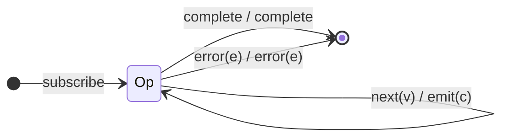

# `mapTo` as a Mealy Machine

> `mapTo(value)` emits a **fixed constant** for every source value, ignoring the
> value itself. In RxJS 7 it is literally `map(() => value)`, so its machine is
> `map`'s machine with a constant output function. (It is deprecated in favour
> of `map(() => value)`, but still shipped.)

Signature:

```ts
mapTo<T, R>(value: R)
```

---

## 1. The 6-Tuple  M = (Q, Σ, Λ, δ, λ, q₀)

### Q — States

- `Op` — single operational state (no memory).
- `Done` — terminal.

### Σ — Input alphabet

- `next(v)`, `complete`, `error(e)`.

### Λ — Output alphabet

- `emit(c)` (the constant), `complete`, `error(e)`, `noop`.

### δ, λ

`δ(Op, next) = Op`; the output `λ` ignores `v` entirely and always emits the
captured constant `c`. This is the degenerate projector: the Mealy output does
not depend on the input *value*, only on the input *symbol kind* (`next`).

### q₀ — Initial state

`q₀ = Op`.

---

## 2. State Transition Table (STT)

| # | Current state | Input (Σ)  | Guard | Next state | Output (λ) |
|---|---------------|------------|-------|------------|------------|
| 1 | `Op`          | `next(v)`  | —     | `Op`       | `emit(c)`  |
| 2 | `Op`          | `complete` | —     | `Done`     | `complete` |
| 3 | `Op`          | `error(e)` | —     | `Done`     | `error(e)` |
| 4 | `Done`        | any        | —     | `Done`     | `noop`     |

The defining contrast with `map`: Row 1's output is independent of `v`.

---

## 3. State Transition Diagram (STD)



---

## 4. From STT rows to test cases

- **Row 1** — feed distinct values, assert the **same constant** is emitted each
  time (the value is discarded).
- **Row 2 / Row 3** — completion / error forwarded.

See [`tests/10-mapTo.test.ts`](../../tests/10-mapTo.test.ts).

---

## Relationship to the family

`mapTo(c)` = `map(() => c)`. Same single-state projector as
[`map`](map.md); the only difference is a constant `λ`. See
[`09-transformation-family.md`](../09-transformation-family.md).
